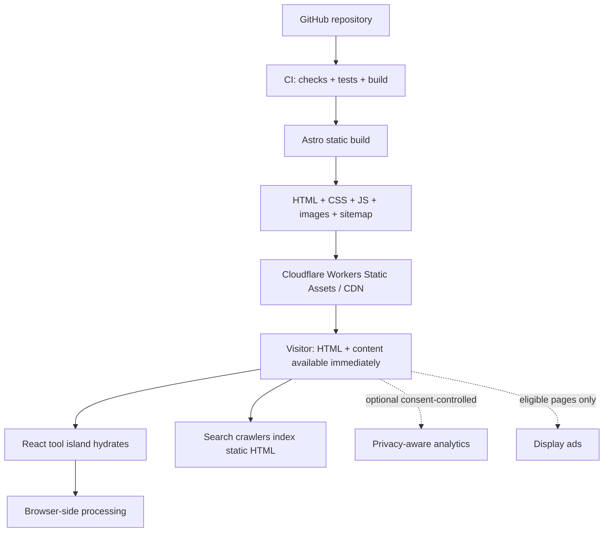

# InfraTrove — Tech Stack & Architecture (v1.0)

> **Mục đích:** Tài liệu kỹ thuật gốc để thiết kế, lập kế hoạch và triển khai InfraTrove. Tập trung vào một website **free online tools + blog**, kiếm traffic từ SEO và monetization chính bằng **display ads**; không thiết kế SaaS hay backend phức tạp.
>
> **Trạng thái:** Bản kiến trúc đề xuất, chưa phải source code đã được triển khai hoặc benchmark hiệu năng. Những lệnh bên dưới là hướng dẫn bootstrap, cần kiểm tra lại tương thích package versions khi chạy.
>
> **Tài liệu song hành:** `InfraTrove_Website_Blueprint_v0.1.md` mô tả sản phẩm và UX. Nếu blueprint với tài liệu này khác nhau ở chi tiết implementation, **tài liệu này ưu tiên cho tech stack**, còn các quyết định business/feature vẫn theo blueprint.

## 1. Executive decision

**Chọn một codebase Astro static-first, các tools tương tác bằng React + TypeScript, nội dung biên tập bằng Markdown/MDX, build tĩnh và phân phối qua Cloudflare Workers Static Assets.**

Các mục tiêu không thay đổi:

- Website tiếng Anh, phục vụ thị trường quốc tế.
- Người dùng mở tool và thao tác **không cần đăng ký**, không có paywall.
- SEO-friendly HTML được tạo tại **build time**.
- Phần lớn phép biến đổi dữ liệu chạy **trong browser**, không upload lên server.
- Chi phí hạ tầng thấp, có thể thêm tool/blog page từng bước.
- Ads chỉ triển khai khi phù hợp, không được làm suy giảm tính riêng tư hoặc tác vụ chính.

### 1.1 Technology decision matrix

| Layer | Lựa chọn | Mức độ | Lý do |
|---|---|---|---|
| Web framework | **Astro**, stable release đã thử nghiệm | **Chọn** | SSG, HTML sẵn, Islands Architecture, content sites |
| Framework version | **Astro 7.x** tại ngày 24/10/2026; pin lockfile | **Baseline cập nhật** | Astro 7 đã phát hành; trước đây thảo luận Astro 6 |
| Runtime build | **Node.js 24 LTS**, phiên bản patch hiện hành | **Đề xuất** | Có thể dùng cùng local + CI; đối chiếu điều kiện của Astro |
| Package manager | **pnpm** | **Chọn** | Lockfile, dependency management |
| Interactive UI | **React + TypeScript** | **Chọn** | Component ecosystem, dễ test và viết riêng từng tool |
| CSS | **Tailwind CSS 4 + CSS variables** | **Chọn** | Thiết kế nhất quán, utility styles, tokens tập trung |
| Content | **Astro Content Collections + Markdown/MDX** | **Chọn** | Git-based, schema, build-time routes |
| Icons | **Lucide** | **Đề xuất** | SVG tối giản, nhất quán |
| Editor | Native textarea; **CodeMirror 6** khi cần | **Theo tool** | Tránh tải editor nặng ở mọi trang |
| Hosting/CDN | **Cloudflare Workers Static Assets** | **Chọn** | Phân phối assets tĩnh toàn cầu, không cần application server |
| CI | **GitHub Actions** | **Chọn** | Typecheck, tests, build, smoke checks |
| Deployment | **Cloudflare Workers Builds** *hoặc* CI deploy qua Wrangler | **Chọn một** | Tránh hai workflow deploy cùng lúc |
| Unit tests | **Vitest** | **Chọn** | Test parsing, generators, converters |
| Browser/E2E | **Playwright** | **Chọn** | Verify interaction, responsive, key flows |
| SEO measurement | **Google Search Console** | **Chọn** | Impressions/clicks/indexing theo URL |
| Product analytics | **GA4** hoặc privacy-conscious analytics | **Chọn sau khi cân nhắc consent** | Không gửi nội dung người dùng nhập |
| Ads | **Google AdSense** khi được duyệt | **Dự kiến** | Monetization, không phải dependency của MVP |
| Database | **Không** | **Không cần** | Không có accounts hoặc server data |
| Backend/API | **Không mặc định** | **Không cần** | Utilities ưu tiên local/client-side |
| User auth | **Không** | **Không cần** | No-login product |
| CMS | **Không** | **Không cần** | Markdown trong Git đủ cho solo founder |

> **Lưu ý version:** Astro 7.0 phát hành ngày 22/06/2026 và có các phiên bản mới hơn trong tháng 10/2026. Để tránh mâu thuẫn giữa `@latest` và một major cũ, **bootstrap bằng bản stable hiện hành**, sau đó commit `pnpm-lock.yaml` và dùng cùng lockfile trên CI. Không nâng major tự động trên production. Node cần đáp ứng yêu cầu tối thiểu của release cụ thể.

### 1.2 Architecture principles

1. **Static first:** mọi landing page phải có HTML đầy đủ tại build time.
2. **Islands only where necessary:** JS tương tác chỉ load trên vùng thực sự cần.
3. **Correctness > feature count:** tool phải test được edge cases, báo lỗi rõ.
4. **No secrets to backend:** không có endpoint nhận password/JWT/JSON/text người dùng nhập.
5. **Privacy before Ads:** script quảng cáo và analytics không được đọc dữ liệu nhạy cảm của tool.
6. **Consistent UX:** tool pages có layout và design tokens chung.
7. **SEO follows usefulness:** không tạo trang rỗng hoặc near-duplicate để tăng URL count.
8. **Simple deploy:** một repo, một static build, một CDN.

## 2. Scope: có và không có

### 2.1 In scope (v1)

- Homepage, Tool Directory, categories, tool detail pages.
- Blog listing + article pages, About/Contact/Privacy/Terms.
- Search tool nhanh; Favorites lưu local (không chứa input).
- Light/dark theme, responsive UI, keyboard usability.
- SEO metadata, sitemap, canonical, robots.txt, Open Graph.
- Ứng viên tools đầu tiên: Password Generator, Text Compare, Cron Generator, JSON Formatter, Unix Timestamp, Base64, JWT Decoder, UUID Generator; chính xác launch batch chốt sau keyword validation.
- Quality gates: lint/typecheck/tests/build/E2E smoke.
- Search Console, analytics được cấu hình an toàn, Ads ở giai đoạn sau.

### 2.2 Explicit non-goals

- Cloud cost SaaS, monitoring, paid APIs, subscriptions, user account/team management.
- Kubernetes cluster, microservices, Redis, PostgreSQL, server queues.
- Tự động lưu nội dung được paste vào history, URL, cookies, analytics.
- Server-side processing PDF/video/image dung lượng lớn ở giai đoạn đầu.
- AI inference API trả tiền cho mỗi lần user dùng tool.
- Mass-generated SEO pages không có giá trị riêng.

## 3. System architecture



### 3.1 Request lifecycle

1. Browser gọi `/tools/text-compare/`.
2. Cloudflare trả về HTML đã prerender, CSS và assets liên quan.
3. H1, metadata, công dụng, examples, FAQ/editorial text, related tools và breadcrumbs đã xuất hiện ở HTML build-time.
4. React island của tool hydrate để chạy logic. Chỉ tool đang dùng mới cần JS tương ứng.
5. Text diff tính trong tab của người dùng; **không có network request để xử lý input**.
6. Analytics (nếu được bật và có consent phù hợp) chỉ ghi **event metadata**, không có raw input/output.

### 3.2 Vì sao không dùng Next.js làm mặc định?

Next.js vẫn SEO tốt và có static export. Tuy nhiên InfraTrove thiên về **content + interactive widgets**, nên Astro ít cần tổ chức app-level hydration, backend conventions và runtime server. Đây là lựa chọn về độ phù hợp, không phải tuyên bố Next.js kém SEO.

### 3.3 Static hosting economics

Cloudflare Workers Static Assets công bố **static asset requests miễn phí và không giới hạn** theo chính sách tại thời điểm nghiên cứu; những request thực thi Worker scripts/SSR có chính sách billing riêng. Điều này không đồng nghĩa mọi chi phí của InfraTrove bằng $0: vẫn có domain, analytics/third-party services (nếu dùng), thời gian vận hành và thay đổi chính sách nhà cung cấp.

**Quyết định:** Không cấu hình Worker `main` hoặc `run_worker_first` cho site tĩnh v1, trừ khi có lý do đã được xác minh. Tránh biến mọi page request thành billable Worker execution.

## 4. Information architecture & route strategy

### 4.1 Định tuyến

```text
/
/tools/
/tools/password-generator/
/tools/text-compare/
/tools/cron-generator/
/tools/json-formatter/
/tools/unix-timestamp/
/tools/base64/
/tools/jwt-decoder/
/tools/uuid-generator/
/blog/
/blog/<post-slug>/
/about/
/contact/
/privacy/
/terms/
/404.html

# Future, only after keyword/UX validation:
/cheatsheets/
/examples/
```

**URL convention đề xuất:** lowercase kebab-case và **trailing slash nhất quán** cho HTML pages. Canonical, sitemap và nội bộ phải dùng cùng một URL chuẩn. Nếu chọn không có trailing slash thì thay đổi đồng bộ cấu hình Astro/Cloudflare trước launch; không để hai URL khác nhau index cùng nội dung.

### 4.2 Tool page anatomy

```text
Header: Logo | Tools | Blog | Search / Command palette | Theme
Breadcrumbs: Home > Tools > JSON Formatter
H1: JSON Formatter & Validator
Short value proposition + note on privacy

[ Interactive tool (above the fold) ]
[ Input / Output / Clear / Copy / Error states ]

How to use (concise steps)
Examples / supported formats / limitations
Common errors / troubleshooting
Related tools
Related blog guides
Footer: About, Contact, Privacy, Terms
```

Không đặt quảng cáo hoặc hero block lớn giữa H1 và vùng tool input. Trên mobile, primary action phải dễ chạm và editor có kích thước hợp lý.

### 4.3 Homepage

- Headline rõ: **Free Online Tools for Everyday Work** (tagline có thể đổi sau).
- Search tools nổi bật, có thể filter theo category.
- Popular / recently added tool cards (không dùng fake usage counts).
- Group by Text, Data, Generators, Time & Scheduling, Networking, Web.
- Links tới một số evergreen articles/chủ đề có liên quan.
- Footer trust/legal đầy đủ.

### 4.4 Content organization

| Loại nội dung | Source | Route | Rendering |
|---|---|---|---|
| Homepage | `.astro` | `/` | Static |
| Tool directory | registry + metadata | `/tools/` | Static + client search |
| Tool detail | `.astro` page + React island | `/tools/<slug>/` | Static + island |
| Blog listing | Content Collection | `/blog/` | Static |
| Blog article | Markdown/MDX | `/blog/<slug>/` | Static |
| Legal pages | `.astro` / Markdown | `/privacy/`, `/terms/` | Static |
| Cheat sheets | Markdown + components | Khi được duyệt | Static |

## 5. Repository structure

**Một repo** là đủ. Không tách packages/monorepo khi mới có vài tools.

```text
infratrove/
├── public/
│   ├── favicon.svg
│   ├── robots.txt
│   └── images/
├── src/
│   ├── assets/
│   ├── components/
│   │   ├── layout/             # Header, Footer, Breadcrumbs
│   │   ├── seo/                # HeadMeta, JSON-LD helpers
│   │   ├── tools/              # ToolShell, Editor, CopyButton, InputRow
│   │   └── ui/                 # Button, Card, Search, ThemeToggle
│   ├── content/
│   │   ├── blog/               # Markdown/MDX articles
│   │   └── tools/              # Per-tool descriptions + SEO content (optional)
│   ├── content.config.ts
│   ├── data/
│   │   ├── tool-registry.ts    # Navigation + relation metadata
│   │   └── categories.ts
│   ├── layouts/
│   │   ├── BaseLayout.astro
│   │   ├── ToolLayout.astro
│   │   └── BlogLayout.astro
│   ├── lib/
│   │   ├── seo/
│   │   ├── analytics/
│   │   └── utils/
│   ├── pages/
│   │   ├── index.astro
│   │   ├── 404.astro
│   │   ├── tools/
│   │   │   ├── index.astro
│   │   │   ├── password-generator.astro
│   │   │   ├── text-compare.astro
│   │   │   ├── json-formatter.astro
│   │   │   └── ...
│   │   ├── blog/
│   │   │   ├── index.astro
│   │   │   └── [...id].astro
│   │   ├── about.astro
│   │   ├── contact.astro
│   │   ├── privacy.astro
│   │   └── terms.astro
│   ├── styles/
│   │   └── global.css
│   └── tools/
│       ├── password-generator/
│       │   ├── PasswordGenerator.tsx
│       │   ├── logic.ts
│       │   ├── logic.test.ts
│       │   └── types.ts
│       ├── text-compare/
│       ├── cron-generator/
│       └── json-formatter/
├── tests/
│   └── e2e/
├── .github/
│   └── workflows/
│       └── ci.yml
├── astro.config.mjs
├── wrangler.jsonc
├── package.json
├── pnpm-lock.yaml
├── tsconfig.json
├── .nvmrc
└── README.md
```

**Quan trọng về Astro hydration:** `client:*` directive chỉ hỗ trợ UI framework components được import trực tiếp vào `.astro` file; **không dùng một dynamic React component map tại runtime** rồi mong `client:load` hoạt động. Ở v1 mỗi tool có một `.astro` route mỏng import trực tiếp component của nó, dùng chung `ToolLayout`. Registry dùng cho navigation/search/metadata, không cố render dynamic islands bằng string key. Nếu hàng trăm tools mới nghiên cứu build-time code generation.

## 6. Bootstrapping & commands

### 6.1 Prerequisites

- Node.js 24 LTS (patch mới), pnpm hiện hành.
- Cloudflare account + domain đã cấu hình khi deploy production.
- GitHub repo.
- Chạy cùng Node major/version trên local và CI; commit lockfile.

### 6.2 Create project

```bash
pnpm create astro@latest infratrove
cd infratrove

pnpm astro add react
pnpm astro add mdx
pnpm astro add sitemap
pnpm astro add tailwind

pnpm add -D @astrojs/check typescript wrangler vitest @playwright/test
pnpm add lucide-react
```

- Chọn starter tối giản và output static.
- `astro add tailwind` cho Astro hiện đại dùng **Tailwind 4 Vite plugin**, không cần `@astrojs/tailwind` (legacy integration).
- Cài tool-specific packages **khi build tool tương ứng** (ví dụ `diff`, `yaml`, `cron-parser`) thay vì thêm tất cả ngay từ đầu.
- Chạy `pnpm exec playwright install chromium` trước khi chạy E2E ở môi trường mới.
- Sau khi bootstrap, kiểm tra lại dependencies/version compatibility, lint config và CSS import do generator tạo.

### 6.3 Suggested `package.json` scripts

```json
{
  "scripts": {
    "dev": "astro dev",
    "build": "astro build",
    "preview": "astro preview",
    "check": "astro check",
    "test": "vitest run",
    "test:watch": "vitest",
    "test:e2e": "playwright test",
    "deploy": "pnpm run build && wrangler deploy"
  }
}
```

> `astro check`/Vitest/Playwright cần có config phù hợp project thực tế; script ở trên là baseline chứ không phải chứng nhận một repo hiện có đã chạy pass.

### 6.4 Astro config

```js
// astro.config.mjs
import { defineConfig } from 'astro/config';
import react from '@astrojs/react';
import mdx from '@astrojs/mdx';
import sitemap from '@astrojs/sitemap';
import tailwindcss from '@tailwindcss/vite';

export default defineConfig({
  site: 'https://infratrove.com', // Chỉ dùng sau khi sở hữu domain
  output: 'static',
  trailingSlash: 'always',
  integrations: [react(), mdx(), sitemap()],
  vite: {
    plugins: [tailwindcss()],
  },
});
```

`src/styles/global.css`:

```css
@import "tailwindcss";

:root {
  color-scheme: light dark;
}
```

Import global stylesheet một lần tại `BaseLayout.astro`. Tách light/dark tokens sau khi chốt design; không dùng `color-scheme` thay cho implementation theme thực tế.

### 6.5 Example Astro tool route

```astro
---
// src/pages/tools/json-formatter.astro
import ToolLayout from '../../layouts/ToolLayout.astro';
import JsonFormatter from '../../tools/json-formatter/JsonFormatter';
---

<ToolLayout
  title="JSON Formatter & Validator"
  description="Format, validate, and beautify JSON online."
  slug="json-formatter"
>
  <JsonFormatter client:load />
</ToolLayout>
```

- Route tạo sẵn HTML + tool shell có thể render ban đầu.
- `client:load` cho widget cần thao tác ngay. Tool phụ ở dưới trang có thể dùng `client:idle` hoặc `client:visible` nếu hợp lý.
- Nếu SEO content nằm trong Markdown collection, ToolLayout lấy content theo slug build-time; tránh double-maintenance tiêu đề và description.

### 6.6 Cloudflare config

```jsonc
// wrangler.jsonc
{
  "$schema": "./node_modules/wrangler/config-schema.json",
  "name": "infratrove",
  "compatibility_date": "2026-10-24",
  "assets": {
    "directory": "./dist",
    "not_found_handling": "404-page",
    "html_handling": "auto-trailing-slash"
  }
}
```

Không thêm `main`, `binding: ASSETS` hoặc Cloudflare SSR adapter cho **pure-static site**. Chỉ thêm adapter nếu một quyết định mới yêu cầu SSR/on-demand rendering.

```bash
pnpm run build
pnpm exec wrangler dev
pnpm exec wrangler deploy
```

Trước production: kiểm tra canonical, trailing slash redirect, `/404`, sitemap và domain chính. Nếu custom domain chưa mua thì **chưa trỏ production canonical** sang domain không sở hữu; dùng môi trường kiểm tra phù hợp và chặn index preview.

## 7. Component architecture & Tool Registry

### 7.1 Separation of concerns

- **Logic:** pure functions và standard browser APIs, tối đa không phụ thuộc React.
- **UI:** React component cho input, output, reset/copy, trạng thái loading/error.
- **SEO/editorial:** Astro/Markdown, có ví dụ và giải thích do người biên tập kiểm tra.
- **Shared UI:** ToolShell, CopyButton, Field, Banner, Tabs.
- **Registry:** chứa slug, category, tags, related tools, privacy classification, state published.

Ví dụ (định nghĩa đơn giản để minh họa contract):

```ts
export type ToolRegistryItem = {
  slug: string;
  title: string;
  summary: string;
  category: 'text' | 'data' | 'generators' | 'time' | 'networking' | 'web';
  tags: string[];
  relatedTools: string[];
  published: boolean;
  sensitivity: 'ordinary' | 'potentially-sensitive' | 'secret';
};

export const tools: ToolRegistryItem[] = [
  {
    slug: 'password-generator',
    title: 'Password Generator',
    summary: 'Generate cryptographically secure passwords in your browser.',
    category: 'generators',
    tags: ['password', 'security', 'random'],
    relatedTools: ['uuid-generator'],
    published: true,
    sensitivity: 'secret',
  },
];
```

Giữ **single source of truth** cho metadata: hoặc registry chứa bản ngắn và Content Collection chứa long-form content, hoặc dùng một typed source rồi derive registry. Không copy title/description ở năm nơi khác nhau.

### 7.2 Checklist khi thêm một tool

1. Có mục đích và search intent riêng, không trùng hoàn toàn tool khác.
2. Viết `logic.ts` với test cases: normal, empty, malformed, boundary, Unicode/large input nếu có.
3. Viết UI: input/output, example, errors, reset, copy, keyboard.
4. Tạo tool route `.astro` và nội dung giải thích hữu ích.
5. Bổ sung registry/categories/related tools.
6. QA responsive, accessibility, Lighthouse.
7. Kiểm tra analytics/ads/privacy classification.
8. Test build, crawlable HTML, metadata, canonical và sitemap.

## 8. Proposed tool implementations

Không triển khai tất cả trước khi có keyword validation. Đây là **technical requirements** khi một tool được chọn.

| Tool | Core engine | Bắt buộc kiểm tra | Privacy |
|---|---|---|---|
| Password Generator | `crypto.getRandomValues()` | uniform sampling, length, charset, exclusions | Secret |
| Text Compare | `diff`/jsdiff | Unicode, newlines, whitespace, large input | Potentially-sensitive |
| JSON Formatter | `JSON.parse`/`JSON.stringify` | syntax errors, size, deep nesting | Potentially-sensitive |
| Cron Generator | cron parser + humanization | dialect, timezone, DST, next runs | Ordinary |
| Unix Timestamp | JS Date / timezone utilities | seconds vs ms, negative/overflow, zone | Ordinary |
| Base64 | Web APIs + TextEncoder/Decoder | Unicode, URL-safe, invalid strings | Potentially-sensitive |
| JWT Decoder | Base64URL decode + JSON | malformed token, `exp`, signature caveat | Secret |
| UUID Generator | `crypto.randomUUID()` | valid UUID v4, bulk limit | Ordinary |

### 8.1 Password Generator

- Dùng CSPRNG (`crypto.getRandomValues`), **không dùng `Math.random()`**.
- Tránh modulo bias bằng rejection sampling nếu ánh xạ byte sang alphabet.
- Chọn length, upper/lower/digits/symbols, ambiguous characters.
- Không lưu password trong localStorage, logs, query string, error reporting hoặc analytics.
- Copy button và màn hình cảm ứng dễ thao tác; không tự động đưa secret lên clipboard nếu user chưa chọn.

### 8.2 Text Compare

- Side-by-side/unified diff tùy effort.
- Ignore whitespace/line endings có giải thích rõ ảnh hưởng.
- Giới hạn kích thước input để tránh treo tab, có thể dùng Web Worker khi dữ liệu lớn.
- Raw text không được gửi ra third-party scripts hoặc telemetry.

### 8.3 Cron Generator

- Hỗ trợ một cron dialect rõ ràng từ đầu (ví dụ 5-field POSIX-like), không âm thầm trộn Unix, Quartz, Kubernetes, EventBridge.
- Next execution preview cần sử dụng timezone rõ ràng, xử lý DST/ambiguous times đúng.
- Với dialect không hỗ trợ, báo lỗi rõ thay vì cho kết quả có vẻ chính xác.

### 8.4 JWT Decoder

- Decode **không đồng nghĩa verify signature**, UI phải nói rõ.
- Không tự động gọi JWKS endpoint/third-party service bằng token đã paste.
- Không gửi token vào URL, storage, analytics, session replay hoặc crash reporting.
- Không khẳng định token hợp lệ chỉ dựa trên payload parse được.

### 8.5 JSON / Base64

- Xử lý lỗi với vị trí/chi tiết hữu ích khi có thể.
- Giới hạn input memory/size; cân nhắc Web Worker với transformations nặng.
- Xử lý Unicode đúng và phân biệt Base64 binary vs UTF-8.
- Không dùng `innerHTML` để render arbitrary user input.

## 9. Design system

### 9.1 Visual direction

- **Modern, minimal, developer-friendly**, ưu tiên utility chứ không phải landing page marketing.
- Light/dark themes; code/technical output dễ đọc.
- Typography: system UI hoặc Inter; monospace cho input/output/code.
- Icons: Lucide nhỏ, thống nhất.
- Có đủ whitespace, contrast, focus states; không dựa chỉ vào màu để báo lỗi.
- Tool được trình bày ngay đầu trang; supporting SEO content ở phía dưới.

### 9.2 Components cần chuẩn hóa sớm

| Component | Hành vi |
|---|---|
| SiteHeader | Logo, Tools, Blog, search, theme |
| ToolSearch | Filter theo title/tags, keyboard-friendly |
| ToolCard | Name, short description, category |
| ToolLayout | H1, description, widget, how-to, related tools |
| ToolShell | Action area, errors, copy, clear, privacy note |
| TextEditor | Accessible textarea mặc định, CodeMirror khi cần |
| CodeOutput | Monospace, wrap toggle, copy |
| Breadcrumbs | Navigation + structured data nếu phù hợp |
| AdSlot | Chỉ render trên page types đã xét privacy/consent |
| BlogLayout | Readable column, TOC khi dài, references |

### 9.3 Interaction/performance principles

- Primary action dễ tìm, không bị quảng cáo che khuất.
- Copy button có trạng thái success/error (không cần toast quá nhiều).
- Không xóa user input do điều hướng nhầm nếu có thể tránh, nhưng **không tự lưu secrets**.
- Favorites và theme preference có thể lưu localStorage (không chứa payload).
- Search index nhỏ, tải theo nhu cầu; không cần Algolia/Elastic cho v1.
- Mobile first, visible focus, screen reader labels, keyboard support.

## 10. SEO architecture

### 10.1 Per-page metadata

- Một H1, descriptive title/description, canonical absolute URL.
- Unique editorial content cho mỗi tool, không tạo hàng loạt trang na ná nhau.
- Semantic HTML: headings, lists, labels, links, tables.
- Open Graph and social preview images nếu hữu ích.
- Breadcrumb links và related tools/contextual blog links.
- Sitemap chỉ gồm indexable, canonical production URLs.
- Có trang 404 trả mã HTTP 404 thật, không soft-404.

### 10.2 Static-first SEO

- Google và các crawler phải đọc được main explanatory text **không cần chạy React**.
- Không lazy-load H1, description hoặc links nội bộ chính bằng JS.
- Tool results theo input người dùng **không index** và không tạo infinite URL combinations.
- Staging/preview phải `noindex` và không đưa vào sitemap production.
- `robots.txt` không thay thế `noindex` khi cần kiểm soát indexation.
- `lastmod` chỉ cập nhật khi nội dung thay đổi thực sự.

### 10.3 Structured data

Chỉ dùng schema type đúng với nội dung hiển thị, có kiểm chứng theo tài liệu Google: `WebSite`, `BreadcrumbList`, `Article`/`BlogPosting` khi phù hợp. Không thêm FAQ schema giả định sẽ có rich results. Không nhồi `SoftwareApplication`/ratings/reviews không có bằng chứng.

### 10.4 SEO measurement

- GSC: impressions, clicks, queries, indexed pages, CTR.
- Analytics: pageviews, tool interaction rate, copy/export actions, returning visits (nếu đo hợp lệ).
- Ads: Page RPM, viewability, revenue by page category sau khi monetized.
- Không coi GSC clicks bằng GA4 pageviews.
- Kết luận ranking/cơ hội SEO cần keyword/SERP research, không chỉ dựa vào việc tool dễ code.

## 11. Privacy, security & third-party scripts

### 11.1 Threat model tối thiểu

**Sensitive inputs:** passwords, access tokens, JWTs, pasted JSON, text diffs, API responses, source code và file contents. Người dùng có thể vô tình paste secrets vào tool bình thường.

**Rủi ro:** Ads scripts, analytics/session replay, CSP yếu, XSS, browser extensions, remote error logging, URL query params, accidental persistence, dependency compromise.

### 11.2 Non-negotiable rules

1. Không gửi raw input/output đến analytics, logs, error-reporting hoặc Ads.
2. Không lưu password, JWT, private keys, pasted text vào localStorage/IndexedDB mặc định.
3. Không đặt secret vào URL/query/fragment khi không có một thiết kế explicit được kiểm tra security.
4. Không có server endpoints xử lý dữ liệu users cho core tools v1.
5. Với trang xử lý sensitive data, **không nhúng third-party scripts** trong cùng execution context; kiểm soát nghiêm ngặt các exceptions.
6. Escape text output; không render arbitrary HTML từ input chưa sanitize.
7. Dependency scanning/update và CSP theo từng môi trường; không copy CSP mẫu thiếu kiểm thử Ads/analytics.
8. Nói chính xác về privacy: client-side **không tự động đồng nghĩa** an toàn nếu trang có script bên thứ ba.

### 11.3 Ads policy by page type

| Page type | Ad placement v1 | Lý do |
|---|---|---|
| Password/JWT/secret tools | **Không** | Data sensitivity |
| Text/JSON/other potentially-sensitive editors | **Mặc định không** | Input có thể chứa bí mật |
| Non-sensitive calculators | Cân nhắc sau approval | Không chắn input hoặc results |
| Blog/cheat sheets | Có thể triển khai sau approval | Dễ bố trí ads ít can thiệp tác vụ |
| Home/tool directory | Cân nhắc rất hạn chế | Duy trì discovery UX |

Sau này có thể nghiên cứu **cross-origin sandbox** cho tool frame để cô lập third-party scripts, nhưng không cần triển khai khi v1 chưa có Ads.

### 11.4 Consent/legal

- Privacy Policy, About/Contact và Terms khi phù hợp.
- Khi dùng Ads/analytics cần đánh giá consent theo khu vực (EEA/UK/Switzerland, v.v.) và chính sách của vendor; không mặc định một cookie banner là đủ.
- Không giả định AdSense approved khi chưa submit/được chấp thuận.
- Đặt `ads.txt` đúng theo network requirements khi đã ký kết.

## 12. Performance & accessibility budgets

### 12.1 Targets (engineering goals, not guaranteed results)

- LCP <= 2.5 s (75th percentile, real-user data).
- INP <= 200 ms (75th percentile).
- CLS <= 0.1 (75th percentile).
- Homepage/blog không hydrate React nếu không cần.
- Tool-specific JS phải code-split; không ship mọi dependencies trên homepage.
- Tối ưu font và images; tránh layout shifts khi load Ads.
- Có graceful fallbacks khi JS bị tắt: tool không chạy được thì vẫn có explanation rõ.

### 12.2 Accessibility

- Semantic labels, contrast, tab order, visible focus.
- Shortcut không chiếm các phím phổ biến của editor/browser.
- Công cụ có thể dùng được với keyboard; thông báo kết quả bằng `aria-live` phù hợp.
- Không chỉ dùng màu xanh/đỏ cho diff/error; có text hoặc symbols bổ sung.

## 13. Testing strategy

### 13.1 Unit tests: logic first

- Password: lengths, alphabets, exclusion sets, CSPRNG usage và non-biased selection.
- Text diff: empty, whitespace/newline, Unicode, long texts.
- JSON: valid/malformed, duplicate keys caveat, deeply nested/larger inputs.
- Cron: next runs, timezone, DST boundaries, unsupported syntax.
- Timestamp: seconds/milliseconds, negative epochs, invalid ranges.
- Base64: invalid padding, Unicode, binary data, Base64URL.
- JWT: invalid JWT, missing claims, unsigned/mismatched content and clear non-verification warnings.

### 13.2 Integration/E2E tests

- Homepage loads, search navigates to right tool.
- Tool page shows title, H1, canonical and explanation in server-rendered HTML.
- Input -> action -> output -> copy works.
- Page does not send raw tool input to network (instrument test page/network).
- Dark/light mode, mobile viewport, keyboard focus.
- Unknown URL returns HTTP 404.
- Production build contains sitemap and expected canonical paths.

### 13.3 Quality gates

For each PR:

```text
format/lint (when configured)
    -> type check
    -> unit tests
    -> Astro build
    -> SEO/static smoke checks
    -> E2E on critical flows (or nightly if slow)
```

Thêm dependency audit và periodic updates; không để PR merge nếu build/unit tests fail.

## 14. CI/CD and environments

### 14.1 Git branches

- `main`: production.
- Feature branches -> PR -> required checks.
- Deploy preview theo PR nếu Cloudflare integration được cấu hình, **không index preview URLs**.

### 14.2 Example GitHub Actions CI

```yaml
name: CI
on:
  pull_request:
  push:
    branches: [main]

jobs:
  check:
    runs-on: ubuntu-latest
    steps:
      - uses: actions/checkout@v4
      - uses: pnpm/action-setup@v4
        with:
          version: 10
      - uses: actions/setup-node@v4
        with:
          node-version: '24'
          cache: pnpm
      - run: pnpm install --frozen-lockfile
      - run: pnpm run check
      - run: pnpm run test
      - run: pnpm run build
```

> Pin Actions to reviewed versions/commit SHAs theo chính sách supply-chain khi triển khai thực tế. `pnpm/action-setup` và `setup-node` version chỉ là ví dụ. E2E có thể chạy job riêng để giữ build nhanh.

### 14.3 Deployment strategy

**Lựa chọn khuyến nghị v1:** Connect GitHub repo vào **Cloudflare Workers Builds** và dùng:

- Build: `pnpm run build`.
- Deploy: `pnpm exec wrangler deploy`.
- Không bật `astro add cloudflare` adapter vì v1 dùng SSG.
- GitHub Actions chỉ kiểm tra code; **không đồng thời deploy** nếu Workers Builds đã đảm nhiệm deploy.

Alternative: GitHub Actions triển khai Wrangler với token quyền tối thiểu. Chọn một workflow sau khi kiểm tra preview, rollback và quyền access.

### 14.4 Operational checklist

- DNS/SSL/domain ownership, redirects `www`/apex canonical.
- Production custom 404.
- Worker/static asset deployment verification.
- Build alert, availability checks nhẹ nếu cần; không dựng monitoring platform.
- Dependency updates định kỳ, backup repo/content.
- Analytics/GSC inspection và Core Web Vitals audit định kỳ.
- Document cách rollback deployment.

## 15. Estimated ongoing operational footprint

Không có revenue/cost forecast từ benchmark đáng tin cậy cho InfraTrove tại thời điểm này. Về kiến trúc, dự kiến:

- Hosting static: chi phí CDN thấp với Cloudflare Static Assets, tuân theo pricing/limits hiện hành.
- Domain: chi phí đăng ký/gia hạn hằng năm.
- CI: chạy khi build/test; tối ưu frequency nếu cần.
- Analytics/CMP/Ads tools: có thể phát sinh phí theo vendor/traffic.
- Maintenance chủ yếu ở dependency updates, correctness tests, content/SEO, policy updates — **không phải vận hành application servers**.

Không nên tính giá trị thời gian founder là 0 khi đánh giá hiệu quả kinh doanh.

## 16. Implementation roadmap (không gắn ETA cứng)

### Phase A — Foundation

- [ ] Tạo repo với Astro/React/TypeScript/Tailwind.
- [ ] Chốt URL canonical convention, domain ownership và deploy environments.
- [ ] Layout, theme, typography, favicon, global components.
- [ ] Homepage, Tool Directory, category/filter/search.
- [ ] Blog Content Collections + 1 mẫu bài.
- [ ] Sitemap, robots, canonical, OG, 404, policy pages.
- [ ] CI, static deploy, basic E2E.

**Exit:** domain phục vụ HTML đúng, robots/sitemap/canonical hoạt động và có thể thêm tool độc lập mà không copy layout.

### Phase B — First tool batch

- [ ] Chọn 3–5 tools thông qua keyword/SERP validation.
- [ ] Logic tests và privacy threat review cho từng tool.
- [ ] Example data, errors, copy, reset, keyboard/mobile UX.
- [ ] Related tools + how-to content.
- [ ] SEO/performance E2E smoke pass.

**Exit:** mỗi tool giải quyết được tác vụ thật, không crash ở edge cases phổ biến.

### Phase C — SEO content and measurement

- [ ] Publishing pipeline cho blog, how-to guides.
- [ ] Setup GSC; verify index/canonical.
- [ ] Analytics events tối thiểu, không có raw user content.
- [ ] Theo dõi impressions/clicks và interaction signals.
- [ ] Dùng evidence để chọn batch tiếp theo.

**Exit:** biết trang nào có tín hiệu acquisition, trang nào cần cải thiện, không chỉ đếm số URL.

### Phase D — Ads readiness

- [ ] Review content quality, About/Privacy/Contact.
- [ ] Consent/CMP theo requirements, áp dụng phân loại sensitivity.
- [ ] Chỉ đặt ad slots ở nơi không làm gián đoạn utility.
- [ ] Kiểm tra CLS, accessibility, policy compliance.
- [ ] Khi đủ điều kiện, submit mạng Ads; đo revenue/Page RPM sau khi approved.

**Exit:** monetization không làm mất niềm tin vào browser-side tools.

## 17. Definition of Done

Một website/tool được coi là sẵn sàng launch khi:

- [ ] Có giá trị thực tế với use case đã chọn; không chỉ landing page.
- [ ] Có HTML tĩnh chứa main SEO content, title/H1/canonical đúng.
- [ ] Tool chạy trong browser và có test edge cases.
- [ ] Input không bị gửi/ghi log ra ngoài ý muốn.
- [ ] Mobile/responsive/keyboard accessibility được kiểm tra.
- [ ] Không có lỗi nghiêm trọng ở console hoặc broken links.
- [ ] Unit tests, Astro build, E2E smoke pass.
- [ ] Sitemap, robots và 404 hoạt động đúng.
- [ ] Policy pages, privacy descriptions phù hợp thực tế.
- [ ] Third-party scripts/Ads được rà soát theo data sensitivity.

## 18. Key trade-offs, risks and open decisions

| Vấn đề | Mặc định | Điểm cần kiểm chứng |
|---|---|---|
| Astro major | Latest stable tested (7.x tại 24/10/2026) | Compatibility với integrations, Node patch version |
| React islands | Có cho interactive tools | Bundle size so với vanilla JS ở very-small tools |
| CodeMirror | Chỉ tool cần editing thật | Byte weight/performance |
| Static-only hosting | Có | Có tool nào thực sự cần server không? |
| Ads trên tool pages | Hạn chế mạnh | Privacy, consent, monetization impact |
| Search/favorites | Local only | User cần cross-device không? Chưa có evidence |
| SEO tool priority | Chưa chốt | Keyword research + SERP audit |
| Content CMS | Git Markdown | Editorial workflow có phức tạp khi scale không? |
| Multi-language | Chưa triển khai | English-first thực sự là lựa chọn tốt? |

### 18.1 Decision log

- **2026-10-24:** Chốt kiến trúc đề xuất **Astro SSG + React Islands + TypeScript + Tailwind + Markdown/MDX + Cloudflare Workers Static Assets**.
- **2026-10-24:** Cập nhật câu trả lời trước: Astro 6 là version đã nhắc trong trao đổi; bản stable mới nhất đã lên **Astro 7**, nên implementation dùng release stable được kiểm tra, không cố ghim Astro 6 chỉ vì câu trả lời cũ.
- **2026-10-24:** Không mặc định có backend, database, auth, SaaS hoặc monitoring application.
- **2026-10-24:** Giữ trọng tâm **SEO + free tools + content + Ads** và xử lý privacy-first.

## 19. References (checked 2026-10-24)

Primary/official docs:

1. Astro 7 release: https://astro.build/blog/astro-7/
2. Astro install requirements: https://docs.astro.build/en/install-and-setup/
3. Astro routing and static paths: https://docs.astro.build/en/guides/routing/
4. Astro hydration directives: https://docs.astro.build/en/reference/directives-reference/
5. Astro Content Collections: https://docs.astro.build/en/guides/content-collections/
6. Astro Styling / Tailwind: https://docs.astro.build/en/guides/styling/
7. Astro Deploy to Cloudflare: https://docs.astro.build/en/guides/deploy/cloudflare/
8. Cloudflare Workers Static Assets: https://developers.cloudflare.com/workers/static-assets/
9. Cloudflare Workers static site + 404: https://developers.cloudflare.com/workers/static-assets/routing/static-site-generation/
10. Cloudflare Workers static asset billing: https://developers.cloudflare.com/workers/static-assets/billing-and-limitations/
11. Google Search people-first content: https://developers.google.com/search/docs/fundamentals/creating-helpful-content
12. Google SEO Starter Guide: https://developers.google.com/search/docs/fundamentals/seo-starter-guide
13. Google JavaScript SEO: https://developers.google.com/search/docs/crawling-indexing/javascript/javascript-seo-basics
14. Web Vitals: https://web.dev/articles/vitals
15. Web Crypto API: https://developer.mozilla.org/en-US/docs/Web/API/Web_Crypto_API

**Data limitations:** Tài liệu này xác minh định hướng framework/hosting theo tài liệu công khai, **không** xác minh organic search volumes, Page RPM, competitor SEO difficulty, conversion hoặc chi phí thực tế của InfraTrove. Những thông số đó thuộc Market Research và Analytics sau launch.

---

## One-page implementation brief

**InfraTrove = Astro SSG website phục vụ HTML tĩnh cho SEO; React Islands xử lý từng tool trên browser; Markdown/MDX cung cấp nội dung; Cloudflare Workers Static Assets phân phối toàn cầu; CI có test + build; analytics và Ads triển khai có kiểm soát theo privacy.**

**Thứ tự code:** Foundation → 3–5 tools đã được ưu tiên → Blog + SEO → Analytics → Ads.

**Điều không làm:** backend khi chưa cần, SaaS, accounts, cloud cost/monitoring, microservices, và các SEO pages chỉ tồn tại để tăng số lượng URL.
