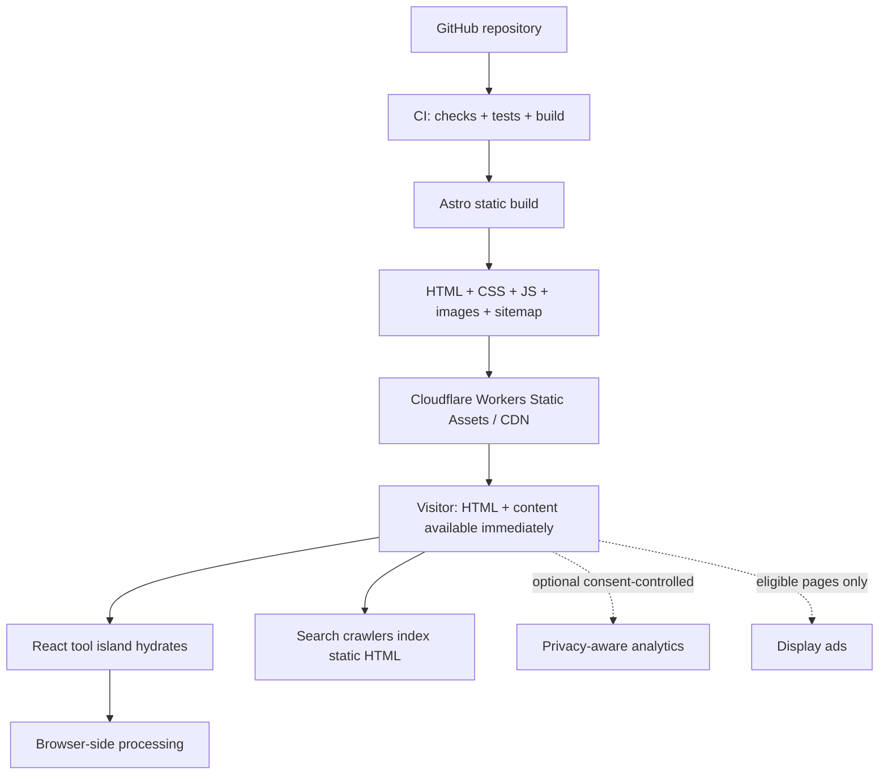

# InfraTrove — Tech Stack & Architecture (v1.0)

> **Purpose:** Foundational technical document to design, plan, and implement InfraTrove. Focuses on a **free online tools + blog** platform, acquiring traffic via SEO with primary monetization through **display ads**; intentionally avoids complex SaaS abstractions or heavy backends.
>
> **Status:** Proposed technical baseline; not a finalized production benchmark or complete source codebase. Commands listed below are bootstrap guides and require package version compatibility checks at execution time.
>
> **Companion Document:** [feature.md](feature.md) defines product and UX requirements. If this technical document differs from the product blueprint in implementation details, **this document takes precedence for tech stack specifications**, while catalog status and tool priorities follow §5 of the product blueprint.

## 1. Executive decision

**Select an Astro static-first codebase, interactive tools powered by React + TypeScript islands, editorial content authored in Markdown/MDX, built statically, and globally distributed via Cloudflare Workers Static Assets.**

Inflexible core objectives:

- English website targeting international global search audiences.
- Users open a tool and complete their task **without signing up**, free of paywalls.
- SEO-friendly HTML generated at **build time**.
- The vast majority of data transformations execute **inside the user's browser**, never transmitted to a server.
- Low infrastructure overhead with gradual, incremental tool and blog additions.
- Display advertising integrated only where appropriate, never compromising user privacy or the primary utility task.

### 1.1 Technology decision matrix

| Layer | Selection | Status | Rationale |
|---|---|---|---|
| Web framework | **Astro**, tested stable release | **Selected** | SSG, pre-rendered HTML, Islands Architecture, ideal for content sites |
| Framework version | **Astro 7.x** as of October 24, 2026; pinned lockfile | **Updated baseline** | Astro 7 is the stable major release; supersedes initial Astro 6 exploratory discussions |
| Build runtime | **Node.js 24 LTS**, current patch version | **Proposed** | Parity between local development and CI; conforms to Astro requirements |
| Package manager | **pnpm** | **Selected** | Deterministic lockfile, efficient disk and dependency management |
| Interactive UI | **React + TypeScript** | **Selected** | Rich component ecosystem, testable pure functions per tool |
| CSS | **Tailwind CSS 4 + CSS custom properties** | **Selected** | Consistent design tokens, utility classes, centralized styling |
| Content | **Astro Content Collections + Markdown/MDX** | **Selected** | Git-backed, strict schema validation, build-time routing |
| Icons | **Lucide** | **Proposed** | Minimalist, consistent, lightweight SVG icons |
| Editor | Native textarea; **CodeMirror 6** when essential | **Per-tool** | Prevents shipping heavy editor bundles to pages that do not need them |
| Hosting/CDN | **Cloudflare Workers Static Assets** | **Selected** | Global static asset distribution without requiring application servers |
| CI | **GitHub Actions** | **Selected** | Typecheck, test execution, production build, smoke tests |
| Deployment | **Cloudflare Workers Builds** *or* CI deploy via Wrangler | **Select one** | Prevents race conditions from two simultaneous deploy pipelines |
| Unit tests | **Vitest** | **Selected** | Fast in-memory testing for parsing, generators, and converters |
| Browser/E2E | **Playwright** | **Selected** | Validates user interaction, responsiveness, and critical workflows |
| SEO measurement | **Google Search Console** | **Selected** | URL-level impressions, clicks, ranking queries, and index coverage |
| Product analytics | **GA4** or privacy-conscious analytics | **Subject to consent** | Strictly zero transmission of user-entered payload data |
| Ads | **Google AdSense** upon approval | **Planned** | Monetization layer, not an architectural dependency of the MVP |
| Database | **None** | **Not needed** | Zero user accounts, server-side persistence, or relational data |
| Backend/API | **None by default** | **Not needed** | Utilities prioritize 100% local, client-side execution |
| User auth | **None** | **Not needed** | Pure no-login utility model |
| CMS | **None** | **Not needed** | Markdown managed in Git is sufficient and optimal for a solo founder |

> **Version Note:** Astro 7.0 was released on June 22, 2026, with successive maintenance updates in October 2026. To avoid discrepancies between `@latest` and legacy majors, **bootstrap using the current verified stable release**, commit `pnpm-lock.yaml`, and enforce the exact lockfile on CI. Do not auto-bump major dependencies in production. Node runtime must satisfy the engine requirements of the specific release.

### 1.2 Architecture principles

1. **Static first:** Every landing page must deliver fully formed, semantic HTML at build time.
2. **Islands only where necessary:** Interactive JavaScript loads strictly on regions requiring user interaction.
3. **Correctness > feature count:** Every utility must be rigorously tested for edge cases and deliver unambiguous error messages.
4. **No secrets to backend:** Zero server endpoints receive user-pasted passwords, JWTs, JSON, or text inputs.
5. **Privacy before Ads:** Third-party ad scripts and analytics must never access or inspect sensitive tool inputs.
6. **Consistent UX:** Tool pages share standardized layouts, keyboard ergonomics, and design tokens.
7. **SEO follows usefulness:** Never generate empty or near-duplicate doorway pages solely to inflate URL counts.
8. **Simple deploy:** Single repository, single static build artifact, distributed on edge CDN.

## 2. Scope: In Scope vs. Explicit Non-Goals

### 2.1 In scope (v1)

- Homepage, Tool Directory, category browsing, individual tool detail pages.
- Blog directory + article pages, About, Contact, Privacy, Terms.
- Fast client-side tool search; locally persisted Favorites (slugs only, never user input).
- Light/dark theme, responsive mobile-to-desktop UI, full keyboard accessibility.
- SEO metadata, sitemap, canonical links, robots.txt, Open Graph images.
- 8 core tools: Password Generator, Text Compare, Cron Generator, JSON Formatter, Unix Timestamp Converter, Base64 Encoder/Decoder, URL Encoder/Decoder, UUID Generator.
- Completed expansion batch bringing catalog to 12 live tools: YAML ↔ JSON Converter, JWT Decoder, Storage Unit Converter, Hash & Checksum. The next queue begins with Upload / Restore Time Calculator; full scope and sequence detailed in [feature.md](feature.md), updated 2026-10-26. This reflects product prioritization, pending future keyword/SEO validation.
- Automated quality gates: formatting, linting, typechecking, unit tests, static validation, Playwright E2E smoke suite.
- Search Console and privacy-safe analytics setup; ad monetization introduced in subsequent phases.

### 2.2 Explicit non-goals

- Cloud cost estimators, infrastructure monitoring, paid APIs, subscriptions, user accounts, or team management dashboards.
- Kubernetes clusters, microservices architectures, Redis caches, PostgreSQL databases, or server queues.
- Automatic persistence of user-pasted content to server logs, URLs, query parameters, cookies, or analytics events.
- Server-side processing of large PDFs, videos, or raw binary assets in initial phases.
- Paid per-invocation AI inference APIs for standard utility tasks.
- Mass-generated, programmatic SEO pages lacking distinct user utility.

## 3. System architecture



### 3.1 Request lifecycle

1. Browser requests `/tools/text-compare/`.
2. Cloudflare CDN immediately returns pre-rendered HTML, global CSS, and static assets.
3. H1, metadata, instructions, examples, FAQ, related tools, and breadcrumbs are present in the build-time HTML.
4. The React island for the specific tool hydrates in the background. Only the active tool's JavaScript is loaded.
5. Text diffing computes directly inside the visitor's browser tab; **no network requests are dispatched to process inputs**.
6. Analytics (if enabled and consent-approved) logs only **high-level event metadata**, never raw input/output.

### 3.2 Why not Next.js by default?

Next.js provides excellent SEO capabilities and static export functionality. However, InfraTrove is structurally centered on **content + self-contained interactive widgets**. Astro eliminates app-level runtime hydration overhead, complex backend conventions, and unnecessary server runtimes. This is an architectural fit decision, not a critique of Next.js SEO capabilities.

### 3.3 Static hosting economics

Cloudflare Workers Static Assets provides **free and unmetered static asset requests** under its standard platform terms; requests that execute Worker scripts or dynamic SSR runtimes follow separate compute billing tiers. This does not imply zero operational cost for InfraTrove: custom domain renewal, analytics services, operator time, and upstream policy updates remain factors.

**Architectural Decision:** Do not configure a Worker `main` entrypoint or `run_worker_first` for pure static v1 pages. Avoid converting ordinary static page requests into billable Worker compute invocations.

## 4. Information architecture & route strategy

### 4.1 Routing structure

```text
/
/tools/
/tools/password-generator/
/tools/text-compare/
/tools/cron-generator/
/tools/json-formatter/
/tools/unix-timestamp-converter/
/tools/base64-encoder-decoder/
/tools/url-encoder-decoder/
/tools/uuid-generator/
/tools/yaml-json-converter/
/tools/jwt-decoder/
/tools/storage-unit-converter/
/tools/hash-checksum/
/blog/
/blog/<post-slug>/
/about/
/contact/
/privacy/
/terms/
/404.html

# Future, only after keyword/UX validation:
/cheatsheets/
/examples/
```

**URL Convention:** Strict lowercase kebab-case with **consistent trailing slashes** for all HTML pages. Canonical tags, sitemaps, and internal links must use the exact canonical path. Prevent dual-indexing of trailing-slash and non-trailing-slash variations.

### 4.2 Tool page anatomy

```text
Header: Logo | Tools | Blog | Search / Command palette | Theme toggle
Breadcrumbs: Home > Tools > JSON Formatter
H1: JSON Formatter & Validator
Short value proposition + note on client-side privacy

[ Interactive tool workspace (above the fold) ]
[ Input / Output / Clear / Copy / Inline Error States ]

How to use (concise step-by-step instructions)
Examples / supported formats / technical limits
Common errors / troubleshooting guide
Related tools
Related blog guides
Footer: About, Contact, Privacy, Terms
```

Never insert banner ads or large visual hero elements between the H1 and the tool workspace. On mobile screens, primary action buttons must have at least 44px tap targets and editors must resize cleanly.

### 4.3 Homepage layout

- Direct headline: **Free Online Tools for Everyday Work** (subject to refinement).
- Prominent search input with category filtering.
- Popular / recently updated tool cards (no fabricated usage statistics).
- Logical category groupings: Text, Data, Generators, Time & Scheduling, Networking, Web.
- Curated links to evergreen guides and technical articles.
- Comprehensive trust and legal footer.

### 4.4 Content organization

| Content Type | Source | Route | Rendering |
|---|---|---|---|
| Homepage | `.astro` | `/` | Static HTML |
| Tool directory | Registry + metadata | `/tools/` | Static HTML + client-side search |
| Tool detail | `.astro` page + React island | `/tools/<slug>/` | Static HTML + island hydration |
| Blog listing | Content Collection | `/blog/` | Static HTML |
| Blog article | Markdown/MDX | `/blog/<slug>/` | Static HTML |
| Legal pages | `.astro` / Markdown | `/privacy/`, `/terms/` | Static HTML |
| Cheat sheets | Markdown + components | When approved | Static HTML |

## 5. Repository structure

A **single, unified repository** is optimal. Avoid monorepo tooling or package splitting during the early product lifecycle.

```text
infratrove/
├── public/
│   ├── favicon.svg
│   ├── robots.txt
│   └── images/
├── src/
│   ├── assets/
│   ├── components/
│   │   ├── layout/             # Header, Footer, Breadcrumbs
│   │   ├── seo/                # HeadMeta, JSON-LD helpers
│   │   ├── tools/              # ToolShell, Editor, CopyButton, InputRow
│   │   └── ui/                 # Button, Card, Search, ThemeToggle
│   ├── content/
│   │   ├── blog/               # Markdown/MDX articles (en + vi)
│   │   └── tools/              # Per-tool descriptions + SEO content (optional)
│   ├── content.config.ts
│   ├── data/
│   │   ├── tools.ts            # Typed tool registry & relation metadata
│   │   └── categories.ts
│   ├── layouts/
│   │   ├── BaseLayout.astro
│   │   ├── ToolLayout.astro
│   │   └── BlogPostLayout.astro
│   ├── lib/
│   │   ├── seo/
│   │   ├── analytics/
│   │   └── utils/
│   ├── pages/
│   │   ├── index.astro
│   │   ├── 404.astro
│   │   ├── tools/
│   │   │   ├── index.astro
│   │   │   ├── password-generator.astro
│   │   │   ├── text-compare.astro
│   │   │   ├── json-formatter.astro
│   │   │   └── ...
│   │   ├── blog/
│   │   │   ├── index.astro
│   │   │   └── [slug].astro
│   │   ├── about.astro
│   │   ├── contact.astro
│   │   ├── privacy.astro
│   │   └── terms.astro
│   ├── styles/
│   │   └── global.css
│   └── tools/
│       ├── password-generator/
│       │   ├── PasswordGenerator.tsx
│       │   ├── logic.ts
│       │   ├── logic.test.ts
│       │   └── types.ts
│       ├── text-compare/
│       ├── cron-generator/
│       └── json-formatter/
├── tests/
│   └── e2e/
├── .github/
│   └── workflows/
│       └── ci.yml
├── astro.config.mjs
├── wrangler.jsonc
├── package.json
├── pnpm-lock.yaml
├── tsconfig.json
├── .nvmrc
└── README.md
```

**Critical Astro Hydration Rule:** Astro's `client:*` directives strictly require UI framework components to be imported statically into `.astro` templates; **do not use dynamic runtime component maps** expecting `client:load` to resolve properly. Each tool maintains a thin `.astro` route that directly imports its React component, wrapped in `ToolLayout`. The registry handles navigation, metadata, and search indexing, without attempting runtime dynamic island instantiation.

## 6. Bootstrapping & commands

### 6.1 Prerequisites

- Node.js 24 LTS (latest patch version), active pnpm installation.
- Configured Cloudflare account and verified domain for production deployment.
- GitHub repository.
- Identical Node versions across local and CI environments; pinned lockfile.

### 6.2 Project initialization

```bash
pnpm create astro@latest infratrove
cd infratrove

pnpm astro add react
pnpm astro add mdx
pnpm astro add sitemap
pnpm astro add tailwind

pnpm add -D @astrojs/check typescript wrangler vitest @playwright/test
pnpm add lucide-react
```

- Initialize with a minimal starter and static output configuration.
- Tailwind 4 uses the official `@tailwindcss/vite` plugin directly within Vite config.
- Install tool-specific packages only when developing the respective tool (e.g., `js-yaml`, `cron-parser`).
- Run `pnpm exec playwright install chromium` before running E2E suites in a new environment.
- Validate dependencies, linting configurations, and CSS imports post-initialization.

### 6.3 Baseline `package.json` scripts

```json
{
  "scripts": {
    "dev": "astro dev",
    "build": "astro build",
    "preview": "astro preview",
    "check": "astro check",
    "test": "vitest run",
    "test:watch": "vitest",
    "test:e2e": "playwright test",
    "deploy": "pnpm run build && wrangler deploy"
  }
}
```

### 6.4 Astro configuration

```js
// astro.config.mjs
import { defineConfig } from 'astro/config';
import react from '@astrojs/react';
import mdx from '@astrojs/mdx';
import sitemap from '@astrojs/sitemap';
import tailwindcss from '@tailwindcss/vite';

export default defineConfig({
  site: 'https://infratrove.com', // Configure once domain ownership is verified
  output: 'static',
  trailingSlash: 'always',
  integrations: [react(), mdx(), sitemap()],
  vite: {
    plugins: [tailwindcss()],
  },
});
```

`src/styles/global.css`:

```css
@import "tailwindcss";

:root {
  color-scheme: light dark;
}
```

Global styles are imported once in `BaseLayout.astro`. Light and dark theme tokens are mirrored in `DESIGN.md`.

### 6.5 Example Astro tool route

```astro
---
// src/pages/tools/json-formatter.astro
import ToolLayout from '../../layouts/ToolLayout.astro';
import JsonFormatter from '../../tools/json-formatter/JsonFormatter';
---

<ToolLayout
  title="JSON Formatter & Validator"
  description="Format, validate, and beautify JSON online directly in your browser."
  slug="json-formatter"
>
  <JsonFormatter client:load />
</ToolLayout>
```

- Pre-renders static shell and SEO markup.
- `client:load` hydrates interactive widgets immediately.
- Explanatory content pulled from Markdown collections avoids duplicated copy maintenance.

### 6.6 Cloudflare Workers configuration

```jsonc
// wrangler.jsonc
{
  "$schema": "./node_modules/wrangler/config-schema.json",
  "name": "infratrove",
  "compatibility_date": "2026-10-24",
  "assets": {
    "directory": "./dist",
    "not_found_handling": "404-page",
    "html_handling": "auto-trailing-slash"
  }
}
```

No `main` Worker entrypoint or SSR adapter is attached to **purely static sites**. An SSR Worker is reserved exclusively for specific, isolated backend endpoints (e.g., guide comments API).

```bash
pnpm run build
pnpm exec wrangler dev
pnpm exec wrangler deploy
```

## 7. Component architecture & Tool Registry

### 7.1 Separation of concerns

- **Logic:** Pure TypeScript functions leveraging standard browser APIs, decoupled from React.
- **UI:** React islands handling input, state transitions, reset/copy actions, and accessible error messages.
- **SEO/Editorial:** Astro templates and Markdown collections containing verified technical guides.
- **Shared Primitives:** ToolShell, CopyButton, Select, Textarea, Alert badges.
- **Registry:** Typed definition of slugs, categories, tags, related tools, and privacy classifications.

Example interface contract:

```ts
export type ToolRegistryItem = {
  slug: string;
  title: string;
  shortTitle: string;
  summary: string;
  category: 'Text & data' | 'Encode & decode' | 'Generators' | 'Time & scheduling';
  tags: string[];
  related: string[];
  steps: string[];
  example: string;
  note: string;
};
```

Maintain a **single source of truth** for metadata to prevent desynchronized descriptions across navigation, sitemaps, and landing pages.

### 7.2 Checklist for adding a new tool

1. Confirm a distinct search intent and discrete user task.
2. Implement isolated pure logic in `logic.ts` with comprehensive unit tests for typical inputs, edge cases, boundaries, and malformed strings.
3. Build the React island: accessible inputs/outputs, sample data loader, error state, reset, copy, and keyboard shortcuts.
4. Create the dedicated `.astro` route in `src/pages/tools/`.
5. Author bilingual companion guides (`en/` and `vi/`).
6. Register the tool in `src/data/tools.ts`.
7. Verify responsive layouts (375px mobile, 1280px desktop) and WCAG contrast in both light and dark themes.
8. Validate build artifacts, static link checker, and Playwright E2E coverage.

## 8. Tool implementation specifications

The table below outlines technical requirements and guardrails. Catalog status and sequencing are governed by §5 of [feature.md](feature.md).

| Tool | Core Engine | Mandatory Checks | Privacy Tier |
|---|---|---|---|
| Password Generator | `crypto.getRandomValues()` | Uniform distribution, charset toggles, character exclusions | Secret |
| Text Compare | In-memory line/word diff | Unicode, line endings, whitespace toggles, large inputs | Potentially sensitive |
| JSON Formatter | Standard JSON parser | Syntax errors, size caps, nested structures, last-key precedence | Potentially sensitive |
| Cron Generator | Standard cron parser | 5-field syntax, timezone conversions, DST shifts, next runs | Ordinary |
| Unix Timestamp | Native Date / temporal math | Seconds vs. milliseconds, negative epochs, UTC/local/ISO | Ordinary |
| Base64 | Web APIs + TextEncoder/Decoder | UTF-8 Unicode, standard vs. URL-safe, malformed padding | Potentially sensitive |
| URL Encoder / Decoder | `encodeURIComponent` / `decodeURIComponent` | Percent-encoding, reserved characters, component vs. full URL | Potentially sensitive |
| UUID Generator | `crypto.randomUUID()` | Valid RFC UUID v4 format, bulk limits | Ordinary |

**Batch 1 Expansion Completed (2026-10-26):**

| Tool | Core Engine / Constraints | Mandatory Checks |
|---|---|---|
| YAML ↔ JSON | Safe parsing, 100k char cap | Reject tags/aliases, parse errors with line numbers, copy/download |
| JWT Decoder | Base64URL + JSON, local only | Malformed token handling, UTC timestamps, prominent unverified disclaimer |
| Storage Unit Converter | Exact rational arithmetic | SI (1000) vs. IEC (1024), 9-decimal precision, invalid character rejection |
| Hash & Checksum | Web Crypto SHA-256 / SHA-512 | Reference vectors, 32 MiB file limit, case-insensitive expected hash compare |

Next implementation queue: Upload / Restore Time Calculator, SQL Formatter, JSON ↔ CSV Converter, Regex Tester, IPv4 / CIDR Calculator, and chmod Calculator. All tools remain client-side without backend compute.

### 8.1 Password Generator

- Uses CSPRNG (`crypto.getRandomValues()`), strictly prohibiting `Math.random()`.
- Avoids modulo bias via rejection sampling when mapping entropy bytes to character sets.
- Configurable length, uppercase, lowercase, numbers, symbols, and exclusion of ambiguous characters (`l`, `1`, `I`, `0`, `O`).
- Never writes passwords to localStorage, browser history, URLs, logs, or analytics.

### 8.2 Text Compare

- Side-by-side and unified diff rendering modes.
- Clear explanatory labels for whitespace and case-insensitivity toggles.
- Input size caps prevent browser tab freezing.
- Raw text is strictly processed in memory and never transmitted externally.

### 8.3 Cron Generator

- Standard Unix 5-field dialect supported cleanly from launch.
- Next execution preview calculates timestamps against an explicit timezone (UTC vs. local).
- Unsupported dialects fail with clear diagnostic messages rather than returning misleading schedules.

### 8.4 JWT Decoder

- Inspects compact three-part JWTs without verifying digital signatures; UI explicitly highlights this disclaimer.
- Does not contact remote JWKS servers or external identity endpoints.
- Tokens are never written to URLs, storage, session replays, or error telemetry.

### 8.5 JSON / Base64

- Detailed line and column indicators for syntax errors where feasible.
- Strict size boundaries with Web Worker offloading for heavier workloads.
- Flawless Unicode UTF-8 handling; Base64 distinguished from URL-safe variants.
- Never injects untrusted user inputs via `innerHTML`.

## 9. Design system

### 9.1 Visual direction

- **Warm paper canvas, hairline borders, ink-black primary buttons, and amber/orange accents.**
- Clean, utilitarian, high-contrast developer aesthetic; avoids generic neon cyberpunk tropes.
- Dual light and dark themes with WCAG 2.2 AA contrast compliance.
- Typography: System UI sans-serif; monospace for code, timestamps, and structured outputs.
- Tool workspaces positioned immediately above the fold; supporting documentation positioned below.

### 9.2 Core components

| Component | Responsibility |
|---|---|
| SiteHeader | Branding, navigation links, global search trigger, theme toggle |
| ToolSearch | Client-side filter across tool titles and tags, keyboard-accessible |
| ToolCard | Card showing tool symbol, title, summary, tags, and favorite toggle |
| ToolLayout | Standardized shell rendering breadcrumbs, H1, island workspace, and guides |
| ToolShell | Universal workspace wrapper with action bars, error banners, and copy buttons |
| Select | Custom accessible combobox replacing unstyled OS native dropdowns |
| CopyButton | Accessible clipboard action with instant visual confirmation feedback |
| Breadcrumbs | Semantic hierarchical navigation links |

### 9.3 Interaction and performance principles

- Primary action buttons remain clearly visible and never displaced by dynamic elements.
- Copy actions provide immediate visual confirmation without intrusive toast spam.
- Pasted user input is preserved across syntax validation failures.
- Slugs for locally favorited tools are stored in localStorage; user payloads are never stored.
- Fully accessible keyboard navigation, visible focus indicators, and screen reader announcements.

## 10. SEO architecture

### 10.1 Per-page metadata

- Single `<h1>`, descriptive title tag, meta description, and self-referential canonical URL.
- Unique, high-signal editorial content per tool to prevent doorway page penalties.
- Semantic HTML5 structure (headings, lists, labels, landmarks).
- Open Graph and Twitter Card tags with preview artwork.
- Breadcrumb navigation and contextual internal links between tools and guides.
- XML sitemaps strictly contain indexable, canonical production URLs.
- Custom 404 page returning genuine HTTP 404 status codes.

### 10.2 Static-first SEO

- Search crawlers receive full explanatory copy and documentation **without executing client JavaScript**.
- Core editorial content is never hidden behind client-side fetch calls.
- User input states are not indexed and cannot generate infinite URL permutations.
- Staging and preview environments default to `noindex` headers and are excluded from production sitemaps.

### 10.3 Structured data

Deploy validated schema types matching visible page content: `WebSite`, `BreadcrumbList`, and `BlogPosting`. Avoid invalid or speculative schemas.

### 10.4 SEO measurement

- Google Search Console: Query impressions, clicks, ranking positions, index status, and CTR.
- Analytics: Pageviews, engaged sessions, copy interactions, and return visits.
- Ad reporting: Page RPM, viewability metrics, and category revenue once monetized.
- Never conflate Search Console click counts with web analytics pageviews.

## 11. Privacy, security & third-party scripts

### 11.1 Threat model

**Sensitive Inputs:** Passwords, private keys, API secrets, tokens, internal configs, database dumps, and source code. Users routinely paste sensitive credentials into online utilities.

**Primary Vectors:** Unaudited ad scripts, analytics session replay tools, loose CSP headers, XSS vulnerabilities, browser extensions, remote error logging, URL leakage, and dependency supply-chain attacks.

### 11.2 Inviolable privacy rules

1. Never dispatch raw input/output payloads to analytics, logs, error reporting, or ad networks.
2. Never store passwords, private keys, JWTs, or pasted content in localStorage or IndexedDB.
3. Never append sensitive payloads to URL query parameters or hash fragments.
4. Core utilities operate with zero server-side data processing endpoints.
5. Tool execution contexts remain free of third-party advertising scripts.
6. Escape all rendered outputs; never parse arbitrary user text as HTML markup.
7. Enforce strict Content Security Policies (CSP) and automated dependency audits.
8. Maintain transparent privacy notices: client-side processing is only secure when third-party scripts are completely isolated.

### 11.3 Ad placement policy by page type

| Page Type | Ad Placement | Rationale |
|---|---|---|
| Password, JWT, and secret tools | **None** | High data sensitivity |
| Text, JSON, and code diff editors | **None by default** | Inputs frequently contain confidential data |
| Non-sensitive calculators | Conditional after approval | Positioned cleanly outside task workspace |
| Blog guides and reference articles | Permitted after approval | Easily separated from editorial content |
| Directory and homepage | Very limited | Preserves navigation clarity and discovery |

Future iterations may evaluate cross-origin sandboxed iframes to isolate tool workspaces, but initial releases remain ad-free on tool pages.

### 11.4 Legal and compliance

- Privacy Policy, About, Contact, and Terms pages accurately reflect production architecture.
- Geographically compliant consent management (EEA/UK/GDPR) enforced prior to activating advertising scripts.
- Verified `ads.txt` deployed upon joining official ad exchange networks.

## 12. Performance & accessibility budgets

### 12.1 Engineering targets

- Largest Contentful Paint (LCP) <= 2.5s (75th percentile).
- Interaction to Next Paint (INP) <= 200ms (75th percentile).
- Cumulative Layout Shift (CLS) <= 0.1 (75th percentile).
- Tool-specific JavaScript split by route; homepage loads zero utility engine bundles.
- Fonts and static assets optimized to prevent FOIT/FOUT and layout shifts.
- Graceful degradation: If JavaScript is disabled, the page provides clear static documentation.

### 12.2 Accessibility baseline

- Semantic labels, high-contrast colors, logical tab sequences, and visible focus rings.
- Keyboard shortcuts never intercept standard browser or editor editing shortcuts.
- Dynamic calculation updates announced through accessible `aria-live` containers.
- Color alone is never used to convey errors or diff modifications; accompanying text and icons are mandatory.

## 13. Testing strategy

### 13.1 Unit tests: logic first

- **Password:** Length constraints, character set distribution, exclusion filters, CSPRNG enforcement.
- **Text Diff:** Empty inputs, whitespace normalization, Unicode support, multiline structures.
- **JSON:** Formatting indentation, minify behavior, syntax error diagnostics, duplicate key handling.
- **Cron:** Schedule calculation, timezone shifts, DST boundaries, invalid expression rejection.
- **Timestamp:** Second and millisecond inputs, negative epochs, invalid date boundaries.
- **Base64:** URL-safe variants, Unicode byte round-tripping, malformed padding detection.
- **JWT:** Three-part syntax parsing, claim inspection, invalid token rejection.
- **Storage:** Exact rational conversions across SI and IEC units, decimal rounding limits.
- **Hash:** Reference vectors for SHA-256 and SHA-512, empty string/file hashing.

### 13.2 Integration & E2E tests

- Navigation from homepage search directly to selected tools.
- Verification of static HTML rendering (H1, title, metadata, instructions).
- Complete user workflows: Input -> Action -> Output -> Clipboard copy.
- Network inspection verifying zero outgoing requests containing user inputs.
- Theme persistence, mobile viewports, and keyboard navigation.
- 404 route handling.
- Build output validation confirming sitemaps, canonical tags, and static assets.

### 13.3 Automated quality gates

Every pull request must satisfy:

```text
pnpm format:check
    -> pnpm check (Astro check + Worker typecheck)
    -> pnpm test (Vitest unit tests)
    -> pnpm build (Static build output)
    -> pnpm test:static (Link, metadata, and indexing validator)
    -> pnpm test:e2e (Playwright cross-browser suite)
```

## 14. CI/CD and environments

### 14.1 Git branch workflow

- `main`: Protected production branch.
- Feature branches submit Pull Requests triggering automated CI checks.
- Preview deployments on PRs enforce `noindex` headers.

### 14.2 GitHub Actions CI workflow

```yaml
name: CI
on:
  pull_request:
  push:
    branches: [main]

jobs:
  check:
    runs-on: ubuntu-latest
    steps:
      - uses: actions/checkout@v4
      - uses: pnpm/action-setup@v4
        with:
          version: 10
      - uses: actions/setup-node@v4
        with:
          node-version: '24'
          cache: pnpm
      - run: pnpm install --frozen-lockfile
      - run: pnpm run check
      - run: pnpm run test
      - run: pnpm run build
      - run: pnpm run test:static
      - run: pnpm exec playwright install chromium
      - run: pnpm run test:e2e
```

### 14.3 Deployment strategy

**Recommended configuration:** Link the GitHub repository to **Cloudflare Workers Builds**:

- Build command: `pnpm run build`
- Deploy command: `pnpm exec wrangler deploy`
- Pure static builds require no SSR adapter.
- GitHub Actions handles code quality gates; Cloudflare Git integration handles deployment.

### 14.4 Operational checklist

- Verification of apex and `www` canonical domain redirects and SSL certificates.
- Custom 404 page validation.
- Deployment verification across edge POPs.
- Automated dependency audits via Dependabot or equivalent.
- Ongoing Search Console and Core Web Vitals audits.
- Documented rollback procedures via prior commit deployments.

## 15. Operational footprint & economics

In the initial architecture:

- **Static Hosting:** Minimal cost via Cloudflare Workers Static Assets under standard edge delivery terms.
- **Domain:** Annual apex domain registration and renewal fees.
- **CI Compute:** Standard GitHub Actions runners for test and build validation.
- **Analytics/Tools:** Privacy-compliant services operating within free or predictable tiers.
- **Maintenance:** Routine dependency patching, correctness tests, and editorial guide updates — **no server infrastructure management**.

## 16. Implementation roadmap

### Phase A — Foundation

- [x] Repository initialized with Astro 7, React 19, TypeScript, and Tailwind 4.
- [x] Canonical URL configuration, static asset deployment setup.
- [x] Warm paper design tokens, global layout shell, and accessible primitives.
- [x] Homepage, Tool Directory, search filtering, and localized navigation.
- [x] Content Collections for bilingual guides (`en/` and `vi/`).
- [x] Sitemap, robots.txt, canonical links, and custom 404 page.
- [x] Full CI test suite (Vitest + Playwright + Static checker).

### Phase B — Core & Expansion Tools

- [x] 8 core utilities launched and verified.
- [x] Batch 1 expansion completed: YAML ↔ JSON Converter, JWT Decoder, Storage Unit Converter, Hash & Checksum.
- [x] 4 comprehensive companion guides published in English and Vietnamese.
- [ ] Evaluate next priority queue starting with Upload / Restore Time Calculator.
- [ ] Maintain unit test suites and privacy threat reviews for every addition.

### Phase C — SEO, Content & Measurement

- [ ] Ongoing publication of high-intent technical guides.
- [ ] Search Console verification and indexing monitoring.
- [ ] Privacy-safe aggregate analytics reporting.
- [ ] Query growth analysis to guide future tool selections.

### Phase D — Monetization Readiness

- [ ] Content quality and policy compliance review.
- [ ] CMP consent management integration.
- [ ] Strict isolation of ad placements away from utility workspaces.
- [ ] AdSense submission and verification.

## 17. Definition of Done

A tool or page is considered production-ready when:

- [ ] Delivers genuine user utility for its stated task; not a hollow landing page.
- [ ] Delivers pre-rendered HTML containing complete SEO metadata, instructions, and canonical tags.
- [ ] Executes entirely in the user's browser with verified edge-case test coverage.
- [ ] Zero leakage of user inputs to network endpoints, logs, or analytics.
- [ ] Tested across mobile, tablet, and desktop screen widths with full keyboard accessibility.
- [ ] Zero console errors or broken links.
- [ ] All automated quality gates pass: `format:check`, `check`, `test`, `build`, `test:static`, `test:e2e`.
- [ ] Fully aligned with `DESIGN.md` tokens.
- [ ] Accompanied by bilingual documentation guides (`en/` and `vi/`).

## 18. Decision log & references

### 18.1 Key architectural decisions

- **2026-10-24:** Selected **Astro SSG + React Islands + TypeScript + Tailwind 4 + Markdown/MDX + Cloudflare Workers Static Assets**.
- **2026-10-24:** Confirmed **Astro 7** as stable baseline; rejected unverified runtime adapters.
- **2026-10-24:** Zero default backend, database, authentication, or enterprise SaaS dependencies.
- **2026-10-26:** Deployed Batch 1 expansion bringing live catalog to 12 tools with bilingual guides and refreshed warm paper design system.

### 18.2 Official references

1. Astro Documentation: https://docs.astro.build/
2. Cloudflare Workers Static Assets: https://developers.cloudflare.com/workers/static-assets/
3. Google Search Essentials: https://developers.google.com/search/docs/essentials
4. Web Vitals: https://web.dev/articles/vitals
5. Web Crypto API: https://developer.mozilla.org/en-US/docs/Web/API/Web_Crypto_API
6. NIST Binary Prefixes: https://pml.nist.gov/cuu/Units/binary.html

---

## One-page implementation brief

**InfraTrove delivers high-performance static HTML for organic SEO, hydrates lightweight React islands for in-browser client utilities, presents bilingual editorial guides via Markdown collections, and distributes globally over Cloudflare's static edge with zero tracking and privacy-first engineering.**
