System diagrams often suffer from documentation rot. When drawn in visual drag-and-drop tools, diagrams sit locked inside proprietary binary exports or outdated screenshots. Updating them requires specialized desktop software, and changes cannot be reviewed in git pull requests.

**Mermaid** solves this by treating diagrams as code. By defining nodes, connections, and boundaries in plain text, you can embed living diagrams directly inside Markdown files. GitHub, GitLab, Obsidian, and modern documentation frameworks render them automatically into clean vector graphics.

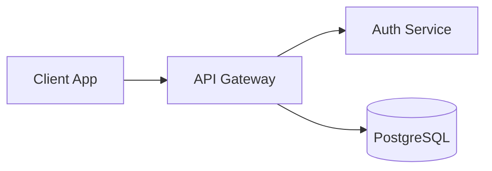

## Primary diagram types

Mermaid supports multiple diagram engines. Each type serves a distinct phase of engineering and architecture design:

| Diagram type             | Primary purpose                                         | Engineering use cases                                     |
| :----------------------- | :------------------------------------------------------ | :-------------------------------------------------------- |
| **Flowchart**            | Directional logic, workflow steps, and network topology | Microservice topology, CI/CD pipelines, ingress routing   |
| **Sequence Diagram**     | Chronological message passing across boundaries         | OAuth2 / OIDC exchanges, gRPC handshakes, API lifecycles  |
| **State Diagram**        | State lifecycles and trigger conditions                 | Kubernetes Pod lifecycle, order statuses, task workers    |
| **Class Diagram**        | Object-oriented models, hierarchies, and interfaces     | Domain-driven design, schema entities, code structure     |
| **ER Diagram**           | Relational schemas and key relationships                | Database design, ORM models, primary/foreign key mappings |
| **Architecture Diagram** | Cloud infrastructure and service groupings              | AWS/GCP system topology, container mesh, network edges    |
| **Gantt Chart**          | Project schedules and dependency timelines              | Migration roadmaps, release schedules, sprint milestones  |
| **Git Graph**            | Commit histories, branches, and merge strategies        | GitFlow branching, release hotfixes, trunk-based releases |

For system architecture, incident response runbooks, and pipeline engineering, the **Flowchart** syntax is by far the most versatile.

## Flowchart structure and layout orientation

Every Mermaid flowchart begins with the `flowchart` keyword followed by a directional orientation code. The body defines nodes, labels, and directional relationships:

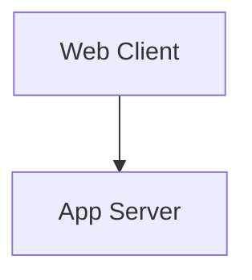

In this definition:

- `flowchart`: Declares the diagram engine.
- `TD`: Layout orientation (Top-Down).
- `Client`, `Server`: Semantic node identifiers.
- `["Web Client"]`: Text displayed inside the rendered shape.
- `-->`: Directed solid connection.

### Diagram orientations

Mermaid supports five layout orientation codes:

| Direction    | Full name                | Common use case                                                |
| :----------- | :----------------------- | :------------------------------------------------------------- |
| `TD` or `TB` | Top-Down / Top to Bottom | Drill-down hierarchies, deployment stages, decision trees      |
| `BT`         | Bottom to Top            | Upstream dependency trees, stack traces, bottom-up aggregation |
| `LR`         | Left to Right            | Pipeline flows, event streams, sequential user journeys        |
| `RL`         | Right to Left            | Reverse data extraction, consumer-to-source tracing            |

Orientation establishes the primary axis for the rendering engine. Individual connections can still branch sideways or loop backward, but the engine calculates the dominant layout direction based on this declaration.

## Node IDs versus display labels

Separating the internal identifier from the displayed text is essential for clean, maintainable diagrams:

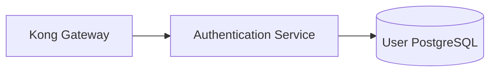

- **Node ID (`api_gw`)**: The unique internal token used across the diagram to wire connections.
- **Node Label (`"Kong Gateway"`)**: The formatted text rendered inside the shape.

### Rules for robust node declarations

1. **Always quote node labels**: Wrapping text in double quotes (`["Label"]`) prevents syntax errors caused by parentheses, brackets, colons, or math operators inside the label.
2. **Reusing IDs references the same node**: Referencing an existing identifier links to that node rather than instantiating a duplicate.
3. **Use semantic, concise IDs**: Avoid placeholder names like `A`, `B`, or `C` in production documents. Use concise domain terms such as `ingress`, `redis_cache`, `worker_pool`, or `s3_bucket`.
4. **Add comments with `%%`**: Use `%%` for inline developer notes. Mermaid ignores comment lines during SVG generation:

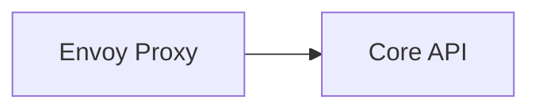

## Node shapes reference

Mermaid determines node shapes from delimiters surrounding the label text. Using the right shape communicates the purpose of each component at a glance:

| Syntax         | Rendered shape    | Recommended architecture usage                          |
| :------------- | :---------------- | :------------------------------------------------------ |
| `id["Text"]`   | Rectangle         | Generic services, microservices, compute instances      |
| `id("Text")`   | Rounded rectangle | Processes, operational tasks, execution steps           |
| `id(["Text"])` | Stadium / Pill    | Terminal states (Start, End, Finished, Failed)          |
| `id[("Text")]` | Cylinder          | Databases, persistent storage, Redis caches             |
| `id{"Text"}`   | Diamond           | Decisions, routing rules, health check branches         |
| `id(("Text"))` | Circle            | Event triggers, milestones, circuit junctions           |
| `id[["Text"]]` | Subroutine        | Reusable pipelines, shared library calls, sub-jobs      |
| `id{{"Text"}}` | Hexagon           | Preparation steps, secrets injection, environment setup |

The following example combines these shapes in an authentication workflow:

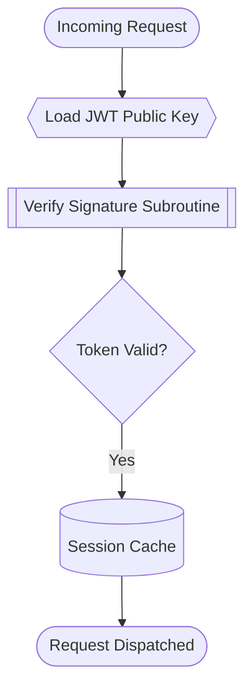

## Edge types and protocol labels

Edges define data transit, call semantics, and dependency couplings between nodes.

### Connection syntax

| Syntax     | Edge style          | Typical architecture meaning                               |
| :--------- | :------------------ | :--------------------------------------------------------- |
| `A --- B`  | Solid line          | Undirected link, peer relationship, network adjacency      |
| `A --> B`  | Solid arrow         | Synchronous call, HTTP request, directional pipeline       |
| `A <--> B` | Bidirectional arrow | Duplex streaming, WebSocket connection, database sync      |
| `A -.- B`  | Dotted line         | Logical boundary, soft association                         |
| `A -.-> B` | Dotted arrow        | Asynchronous message, event dispatch, webhook notification |
| `A === B`  | Thick solid line    | High-capacity trunk, internal bus connection               |
| `A ==> B`  | Thick solid arrow   | Heavy batch pipeline, data lake replication stream         |
| `A --o B`  | Circle-head arrow   | Aggregation, interface exposure, producer-consumer         |
| `A --x B`  | Cross-head arrow    | Blocked traffic, firewall drop, terminated circuit         |

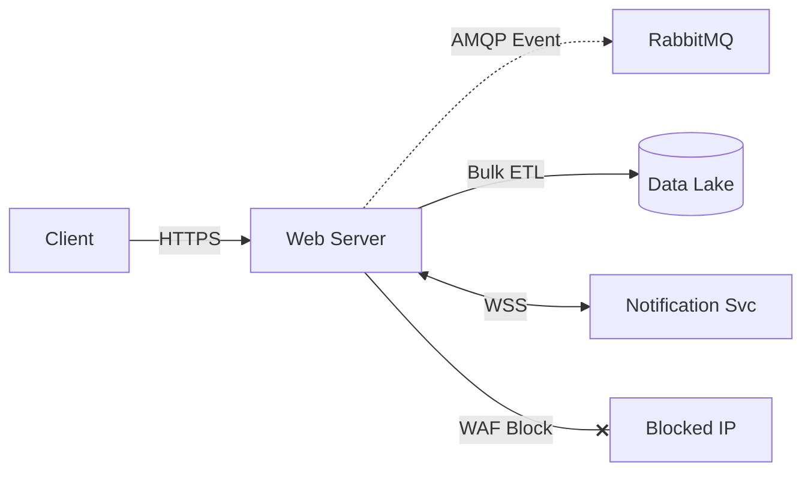

### Labeling edges

Always document the network protocol, payload type, or transition condition on critical links using the `-->|Label|` syntax:

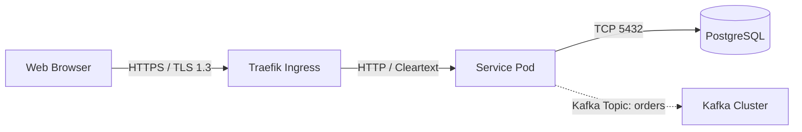

Explicit labels eliminate ambiguity for engineers reviewing network policies, security groups, and firewall rules.

## Subgraphs and system boundaries

Subgraphs group related services into physical or logical zones, such as Virtual Private Clouds (VPCs), Kubernetes namespaces, private subnets, or security perimeters.

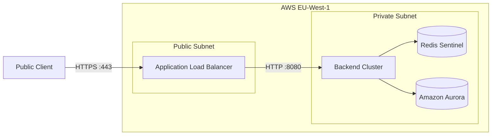

### Controlling subgraph direction

You can assign an internal layout direction to a subgraph using `direction`:

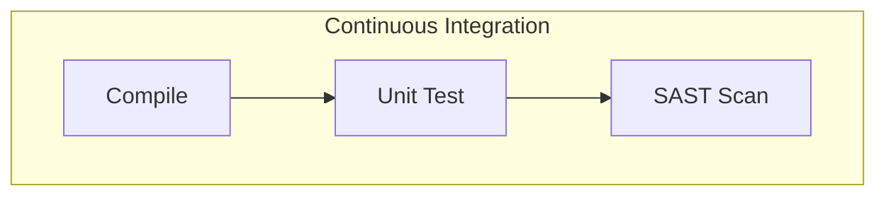

<blockquote class="editorial-quote">
  “When nodes inside a subgraph connect to external nodes outside the boundary, the parent diagram’s layout engine takes precedence. For complex topologies, rely on explicit connection ordering rather than heavy subgraph direction nesting.”
</blockquote>

## Styling with classes and links

Mermaid diagrams can be styled to distinguish tiers (frontend, backend, storage, security).

### Reusable styles with `classDef`

Instead of styling nodes one by one, define reusable classes with `classDef` and apply them with `class`:

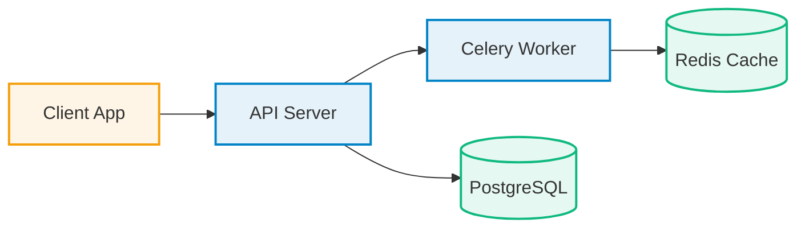

### Edge styling with `linkStyle`

Use `linkStyle` to customize edge colors and stroke widths. Edges are indexed starting at `0` based on declaration order:

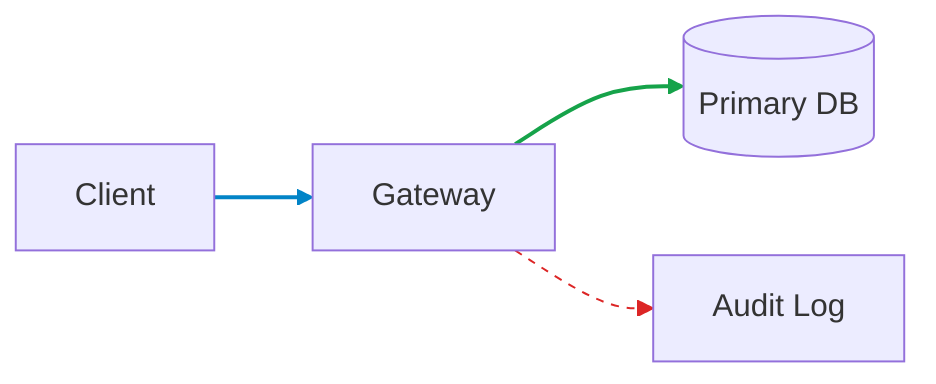

**Maintainability note**: Because `linkStyle` relies on numeric declaration order, inserting or removing an edge shifts all subsequent indexes. For large architecture models, use semantic node classes rather than manual link styling.

## Advanced flows and modern edge animations

In production services, workflows include authentication gates, fallback handlers, and health-check loops:

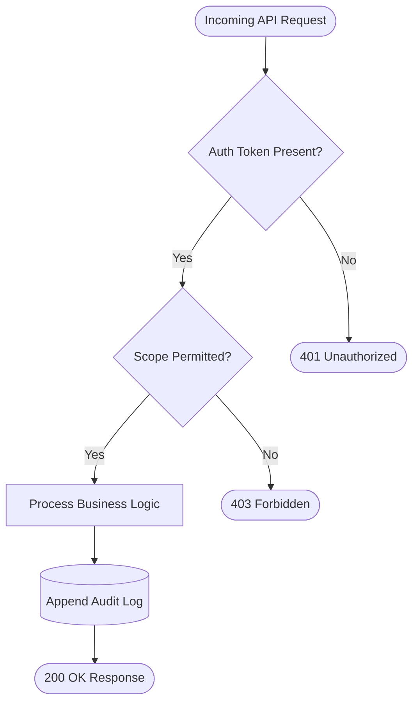

### Edge IDs and animations (Mermaid 11+)

Recent Mermaid releases introduced explicit edge identifiers and declarative animation properties:

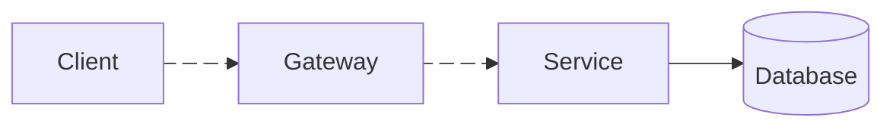

In this syntax:

- `e1@-->`: Assigns the identifier `e1` to the link.
- `e1@{ animation: fast }`: Directs the SVG renderer to display a marching-ant dashed animation along the link path.

Ensure your downstream markdown renderer (such as GitHub Enterprise or older self-hosted wikis) runs Mermaid v11 or newer before relying on edge animation syntax in team repositories.

## Best practices for architecture documentation

  

    <h3 class="takeaways-title">4 rules for production Mermaid diagrams</h3>
    Best Practices
  

  

    

      

        01
        <strong class="takeaway-heading">Semantic IDs</strong>
      

      
Use domain identifiers like <code>auth_gw</code> and <code>order_db</code> so diffs remain readable in pull request reviews.

    

    

      

        02
        <strong class="takeaway-heading">Quote all labels</strong>
      

      
Wrap node text in double quotes to prevent special characters or punctuation from crashing the parser.

    

    

      

        03
        <strong class="takeaway-heading">Label critical protocols</strong>
      

      
Annotate arrows with port numbers and protocols (<code>HTTPS</code>, <code>gRPC</code>, <code>AMQP</code>) for clear security boundaries.

    

    

      

        04
        <strong class="takeaway-heading">Isolate subgraphs</strong>
      

      
Group network boundaries into named subgraphs rather than sprawling, flat connection meshes.

    

  

For inspecting diffs or formatting configuration files side-by-side with your diagrams, use [Text Compare](/tools/text-compare/) and the [JSON Formatter](/tools/json-formatter/).

## References

- [Mermaid Official Documentation](https://mermaid.js.org/)
- [Mermaid Live Editor](https://mermaid.live/)
- [GitHub Diagram Support Guide](https://github.blog/developer-skills/github/include-diagrams-markdown-files-mermaid/)
