Sơ đồ hệ thống thường gặp tình trạng lỗi thời theo thời gian. Khi vẽ bằng các công cụ kéo thả đồ họa, sơ đồ bị khóa trong các định dạng nhị phân đóng kín hoặc ảnh chụp màn hình tĩnh. Mỗi lần cập nhật đòi hỏi phần mềm chuyên dụng và sự thay đổi không thể kiểm tra thông qua pull request trên git.

**Mermaid** giải quyết vấn đề này bằng phương pháp `Diagram as Code` (sơ đồ dạng mã nguồn). Bằng cách định nghĩa node, kết nối và ranh giới hệ thống dưới dạng văn bản thuần, bạn có thể nhúng trực tiếp sơ đồ sống vào tài liệu Markdown. GitHub, GitLab, Obsidian và các hệ thống tài liệu hiện đại sẽ tự động hiển thị chúng thành đồ họa vector SVG sắc nét.

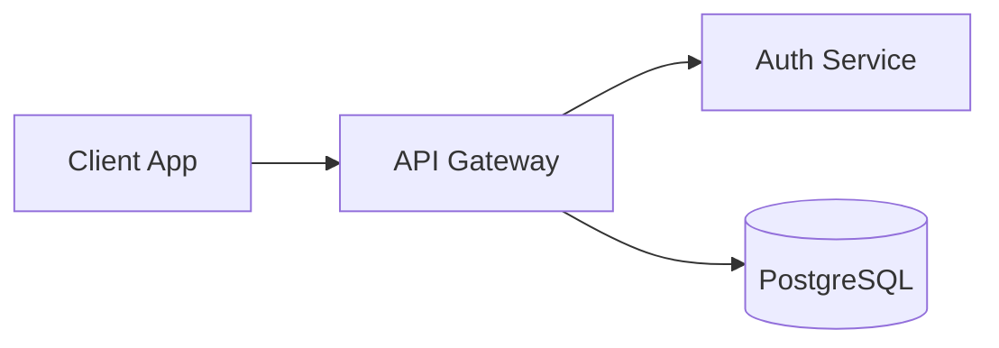

## Các loại sơ đồ chính

Mermaid hỗ trợ nhiều bộ dựng sơ đồ khác nhau. Mỗi loại phục vụ một mục đích chuyên biệt trong thiết kế phần mềm và vận hành hạ tầng:

| Loại sơ đồ               | Mục đích cốt lõi                            | Ứng dụng thực tế                                               |
| :----------------------- | :------------------------------------------ | :------------------------------------------------------------- |
| **Flowchart**            | Luồng xử lý, luồng dữ liệu và topo kết nối  | Kiến trúc microservices, CI/CD pipeline, điều hướng ingress    |
| **Sequence Diagram**     | Trình tự trao đổi thông điệp theo thời gian | Quy trình OAuth2 / OIDC, bắt tay gRPC, vòng đời request API    |
| **State Diagram**        | Trạng thái và điều kiện chuyển đổi          | Vòng đời Pod Kubernetes, trạng thái đơn hàng, tiến trình xử lý |
| **Class Diagram**        | Mô hình hướng đối tượng, quan hệ kế thừa    | Thiết kế DDD, cấu trúc thực thể, cấu trúc mã nguồn             |
| **ER Diagram**           | Cấu trúc dữ liệu và quan hệ khóa            | Thiết kế cơ sở dữ liệu quan hệ, ánh xạ khóa chính / khóa ngoại |
| **Architecture Diagram** | Nhóm thành phần và hạ tầng đám mây          | Topo hạ tầng AWS/GCP, mạng container, phân vùng mạng           |
| **Gantt Chart**          | Lịch trình và tiến độ phụ thuộc             | Lộ trình di chuyển hệ thống, kế hoạch phát hành, mốc sprint    |
| **Git Graph**            | Lịch sử commit, phân nhánh và hợp nhất      | Chiến lược nhánh GitFlow, luồng hotfix, trunk-based release    |

Đối với kiến trúc hạ tầng và quy trình CI/CD, cú pháp **Flowchart** là công cụ phổ biến và linh hoạt nhất.

## Cấu trúc Flowchart và hướng bố trí

Mỗi sơ đồ Flowchart bắt đầu bằng từ khóa `flowchart` kèm theo mã hướng bố trí. Thân sơ đồ định nghĩa các node, nhãn hiển thị và các liên kết:

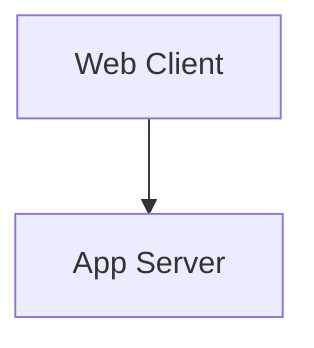

Trong khai báo này:

- `flowchart`: Khai báo loại sơ đồ.
- `TD`: Hướng bố trí (Top-Down - từ trên xuống dưới).
- `Client`, `Server`: Định danh (ID) duy nhất của node.
- `["Web Client"]`: Nhãn văn bản hiển thị trên sơ đồ.
- `-->`: Đường kết nối có mũi tên.

### Các hướng bố trí sơ đồ

Mermaid hỗ trợ 5 cách khai báo hướng:

| Hướng          | Tên đầy đủ               | Trường hợp sử dụng phổ biến                                      |
| :------------- | :----------------------- | :--------------------------------------------------------------- |
| `TD` hoặc `TB` | Top-Down / Top to Bottom | Phân cấp từ trên xuống, các giai đoạn triển khai, cây quyết định |
| `BT`           | Bottom to Top            | Cây phụ thuộc ngược từ dưới lên, phân tích stack trace           |
| `LR`           | Left to Right            | Đường ống pipeline, luồng sự kiện, hành trình người dùng tuần tự |
| `RL`           | Right to Left            | Truy vết nguồn dữ liệu, luồng phản hồi từ consumer về producer   |

Hướng bố trí quy định trục hiển thị chính cho bộ engine sắp xếp. Các kết nối nhánh hoặc vòng lặp quay lại vẫn có thể đi ngược chiều, nhưng tổng thể sơ đồ sẽ được căn theo trục này.

## Node ID và Node Label

Tách biệt định danh nội bộ và nhãn hiển thị là nguyên tắc quan trọng để sơ đồ dễ đọc và dễ bảo trì:

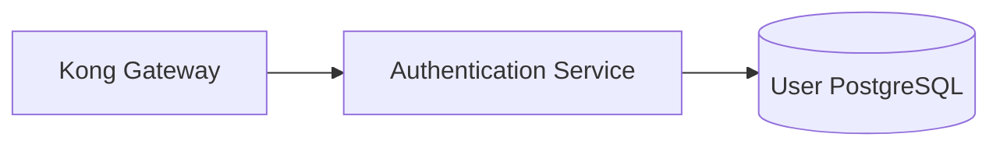

- **Node ID (`api_gw`)**: Mã định danh duy nhất dùng để tham chiếu và liên kết các thành phần.
- **Node Label (`"Kong Gateway"`)**: Nội dung văn bản được vẽ trên hình khối.

### Quy tắc khai báo node an toàn

1. **Luôn đặt nhãn trong dấu ngoặc kép**: Bao bọc nội dung bằng `["Nhãn"]` giúp tránh lỗi phân tích cú pháp khi nhãn chứa dấu ngoặc tròn, ngoặc vuông, dấu hai chấm hoặc ký tự toán học.
2. **Dùng lại ID trỏ về cùng một node**: Khi sử dụng lại một ID đã khai báo, Mermaid sẽ hiểu đó là cùng một node chứ không tạo node mới.
3. **Đặt ID ngắn gọn, có ý nghĩa ngữ nghĩa**: Tránh đặt tên generic như `A`, `B`, `C` trong tài liệu production. Hãy dùng các định danh như `ingress`, `redis_cache`, `worker_pool`, `auth_db`.
4. **Viết ghi chú với `%%`**: Sử dụng `%%` để viết comment nội bộ cho đồng đội. Mermaid sẽ bỏ qua các dòng này khi vẽ sơ đồ:

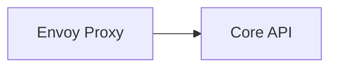

## Các hình dạng Node (Node Shapes)

Mermaid nhận diện hình dạng node dựa trên các cặp ký tự bao quanh nhãn. Sử dụng hình dạng chuẩn giúp người đọc nhận biết vai trò của từng thành phần ngay lập tức:

| Cú pháp        | Hình dạng                          | Ứng dụng kiến trúc đề xuất                              |
| :------------- | :--------------------------------- | :------------------------------------------------------ |
| `id["Text"]`   | Hình chữ nhật (Rectangle)          | Dịch vụ thông thường, microservice, container tính toán |
| `id("Text")`   | Hình chữ nhật bo góc (Rounded)     | Quy trình xử lý, tác vụ tự động, bước thực thi          |
| `id(["Text"])` | Hình sân vận động (Stadium / Pill) | Điểm bắt đầu hoặc kết thúc quy trình (Start, End)       |
| `id[("Text")]` | Hình trụ (Cylinder)                | Cơ sở dữ liệu, kho lưu trữ bền vững, Redis cache        |
| `id{"Text"}`   | Hình thoi (Diamond)                | Điểm rẽ nhánh, kiểm tra điều kiện, rule định tuyến      |
| `id(("Text"))` | Hình tròn (Circle)                 | Sự kiện, mốc kích hoạt, điểm nối giao điểm              |
| `id[["Text"]]` | Quy trình con (Subroutine)         | Pipeline dùng chung, hàm thư viện, tác vụ con lặp lại   |
| `id{{"Text"}}` | Hình lục giác (Hexagon)            | Bước chuẩn bị, nạp secret, cấu hình môi trường          |

Ví dụ phối hợp các hình dạng trong quy trình xác thực API:

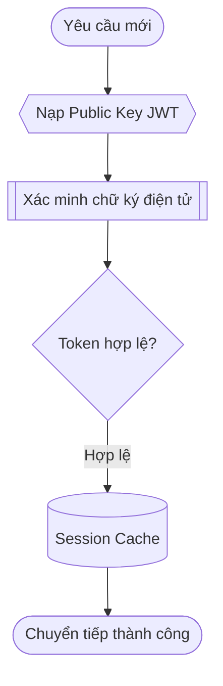

## Các kiểu liên kết (Edge) và nhãn giao thức

Đường kết nối (Edge) biểu diễn luồng dữ liệu, giao thức mạng và mối quan hệ phụ thuộc giữa các thành phần.

### Cú pháp đường kết nối

| Cú pháp    | Kiểu đường             | Ý nghĩa kiến trúc                                               |
| :--------- | :--------------------- | :-------------------------------------------------------------- |
| `A --- B`  | Đường thẳng nét liền   | Liên kết không hướng, quan hệ ngang hàng trong cùng mạng        |
| `A --> B`  | Mũi tên nét liền       | Gọi đồng bộ, yêu cầu HTTP, luồng dữ liệu tuần tự                |
| `A <--> B` | Mũi tên hai chiều      | Kết nối song công (Duplex), WebSocket, đồng bộ hai chiều        |
| `A -.- B`  | Đường nét đứt          | Quan hệ logic mềm, ranh giới liên kết                           |
| `A -.-> B` | Mũi tên nét đứt        | Tin nhắn bất đồng bộ, phát sự kiện (event), webhook             |
| `A === B`  | Đường nét đậm          | Kênh truyền tải băng thông lớn, đường trục nội bộ               |
| `A ==> B`  | Mũi tên nét đậm        | Luồng dữ liệu lô lớn (batch ETL), luồng nhân bản dữ liệu        |
| `A --o B`  | Đầu tròn (Circle-head) | Quan hệ gom tụ, giao diện cung cấp (provider - consumer)        |
| `A --x B`  | Đầu dấu X (Cross-head) | Luồng bị chặn, firewall chặn kết nối, ngắt mạch circuit breaker |

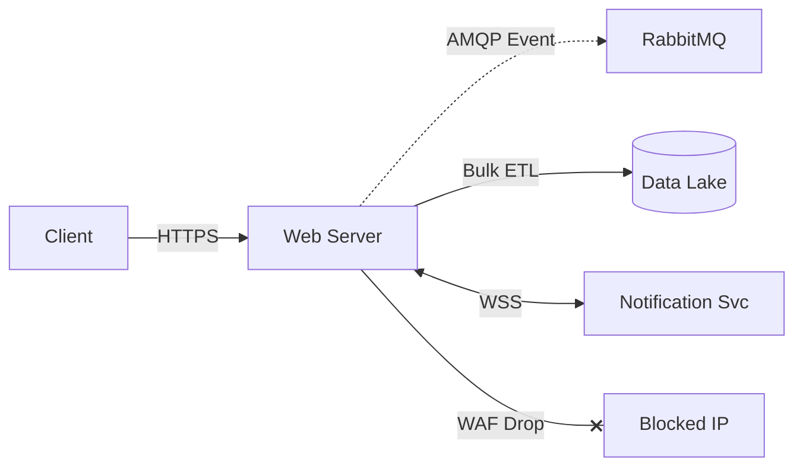

### Đặt nhãn cho đường kết nối

Trong sơ đồ kỹ thuật, hãy luôn ghi rõ giao thức hoặc cổng kết nối trên các liên kết quan trọng bằng cú pháp `-->|Nhãn|`:

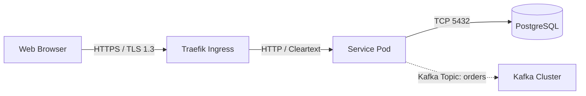

Ghi chú rõ ràng giúp các kỹ sư rà soát Network Policy, Security Group và quy tắc tường lửa nhanh chóng và chính xác.

## Subgraph và ranh giới phân vùng

Subgraph cho phép gom nhóm các dịch vụ có liên quan thành các phân vùng logic hoặc vật lý, chẳng hạn như Virtual Private Cloud (VPC), Kubernetes Namespace, hoặc vùng bảo mật DMZ.

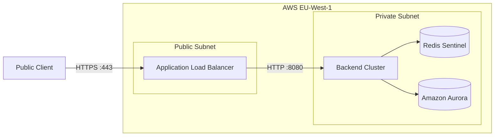

### Điều khiển hướng riêng bên trong Subgraph

Bạn có thể chỉ định hướng bố trí riêng cho một subgraph bằng từ khóa `direction`:

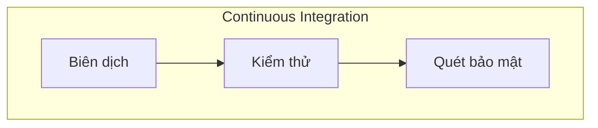

<blockquote class="editorial-quote">
  “Khi các node bên trong subgraph kết nối với các node bên ngoài ranh giới, hướng của sơ đồ cha thường sẽ chiếm quyền ưu tiên. Với các topo phức tạp, hãy dựa vào thứ tự khai báo kết nối thay vì lồng ghép quá nhiều directive direction.”
</blockquote>

## Tùy biến giao diện với Class và Link

Mermaid hỗ trợ CSS-like style để phân biệt trực quan giữa các tầng kiến trúc (gateway, compute, storage).

### Định nghĩa lớp dùng lại với `classDef`

Thay vì gán style thủ công cho từng node, hãy định nghĩa lớp với `classDef` và gán cho danh sách node bằng `class`:

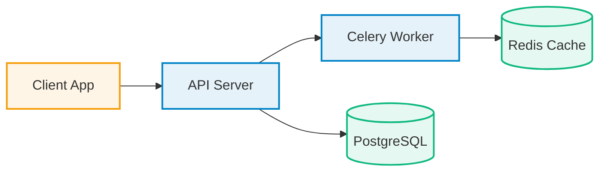

### Định dạng đường nối với `linkStyle`

Sử dụng `linkStyle` để đổi màu và độ dày nét của đường liên kết. Các liên kết được đánh chỉ số bắt đầu từ `0` theo thứ tự khai báo trong mã:

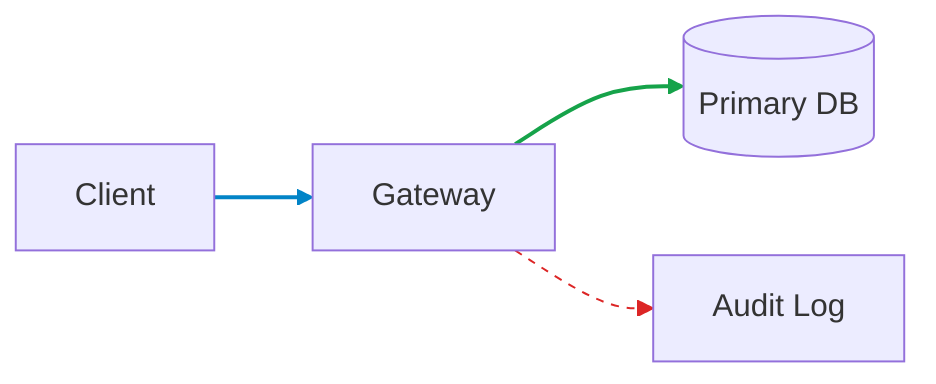

**Lưu ý bảo trì**: Do `linkStyle` phụ thuộc vào chỉ số khai báo, việc thêm hoặc bớt một kết nối sẽ làm lệch toàn bộ chỉ số phía sau. Với sơ đồ lớn, ưu tiên dùng `classDef` cho node thay vì định dạng link thủ công.

## Luồng rẽ nhánh và tính năng hiệu ứng cạnh mới

Trong các hệ thống thực tế, luồng xử lý thường có nhiều điều kiện rẽ nhánh và điểm quay lại:

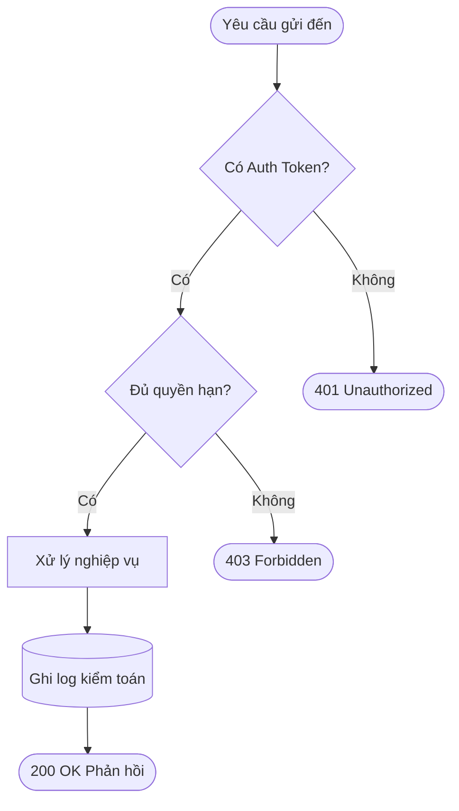

### Định danh Edge và hiệu ứng Animation (Mermaid 11+)

Các phiên bản Mermaid gần đây hỗ trợ gán ID trực tiếp cho đường kết nối và khai báo animation chuyển động:

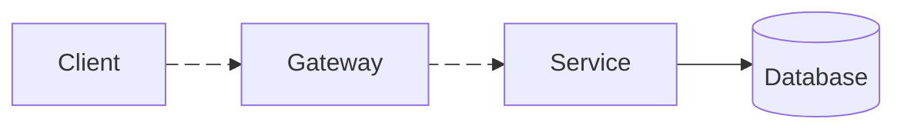

Trong cú pháp này:

- `e1@-->`: Gán định danh `e1` cho đường kết nối.
- `e1@{ animation: fast }`: Yêu cầu bộ dựng SVG hiển thị hiệu ứng chuyển động nét đứt dọc theo đường truyền.

Hãy kiểm tra xem môi trường hiển thị Markdown của đội ngũ bạn (như GitHub Enterprise hoặc wiki nội bộ) đã cập nhật Mermaid v11 trở lên hay chưa trước khi dùng cú pháp animation này trong tài liệu chính thức.

## Nguyên tắc thiết kế sơ đồ kỹ thuật

  

    <h3 class="takeaways-title">4 nguyên tắc vàng khi viết sơ đồ Mermaid</h3>
    Nguyên tắc cốt lõi
  

  

    

      

        01
        <strong class="takeaway-heading">ID mang tính ngữ nghĩa</strong>
      

      
Sử dụng định danh như <code>auth_gw</code> và <code>order_db</code> để diff trong pull request luôn rõ ràng, dễ đọc.

    

    

      

        02
        <strong class="takeaway-heading">Bọc nhãn trong dấu nháy kép</strong>
      

      
Luôn đặt văn bản trong cặp nháy kép để tránh xung đột với các ký tự đặc biệt của cú pháp.

    

    

      

        03
        <strong class="takeaway-heading">Ghi rõ giao thức chính</strong>
      

      
Đính kèm thông tin cổng và giao thức (<code>HTTPS</code>, <code>gRPC</code>, <code>AMQP</code>) trên các đường kết nối quan trọng.

    

    

      

        04
        <strong class="takeaway-heading">Gom nhóm bằng Subgraph</strong>
      

      
Tổ chức ranh giới mạng thành các phân vùng có tên rõ ràng thay vì kết nối tràn lan trên cùng một mặt phẳng.

    

  

Để so sánh các bản diff tài liệu hoặc định dạng file cấu hình đi kèm với sơ đồ, bạn có thể tham khảo [Text Compare](/tools/text-compare/) và [JSON Formatter](/tools/json-formatter/).

## Tham khảo

- [Tài liệu chính thức của Mermaid](https://mermaid.js.org/)
- [Mermaid Live Editor](https://mermaid.live/)
- [Hướng dẫn hỗ trợ Mermaid trên GitHub](https://github.blog/developer-skills/github/include-diagrams-markdown-files-mermaid/)
